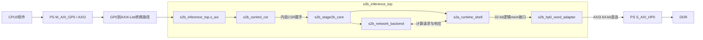

# 阶段2B PS/PL物理接口候选

状态：`CANDIDATE_NOT_FROZEN`。候选编号 `S2B-PHYSICAL-20261009`，版本 `s2b-physical-candidate/0.1.2`。原始逻辑/地址分析基线 `3f6e327a0ff9adc04ed6c98c1578862b8c2fae64`。本版本记录Wong于2026-10-15确认阶段计划中的“验证DMA”按数据搬运功能验收，不要求集成AMD AXI DMA IP；该解释不改变硬件接口信号语义，也不代表G0已关闭。此前 `0.1.1` 原文和历史证据保留；`0.1.0` 被 `0.1.1` 替代的原r01证据与快照仍保留；R1六项候选问题修订见原Run `candidate_revision_result.json`。本版本需重新绑定并独立复核后才能用于G0评审。

## 1. 上游与实施边界

保持 S2A-T01 的逻辑CSR、32-bit单word memory、模型、量化、检测头、PS D9与2A内部timeout周期语义。当前物理候选不例化 `s2a_stage2a_core_ooc`：`s2b_stage2b_core` 将 `s2a_runtime_shell` 与 `s2b_network_backend` 组合；runtime shell复用 `s2a_control_csr` 和 `s2a_memory_master`，网络请求由 `s2b_network_backend` 产生。物理顶层 `s2b_inference_top` 再并列接入 `s2b_control_csr` 与 `s2b_hp0_word_adapter`。因此，本文复用的是冻结逻辑接口与runtime shell，不表示旧2A OOC wrapper本身作为完整子模块被包裹。GP0物理状态不是内层CSR STATUS的别名；即使内层清除owner，外层仍须依据物理事务账本和可见性独立控制DDR归还，软件只信任外层状态。

单CPU0裸机、单驱动、无中断重入/并发提交；CPU1停核，PS DMA/其他PL master/其他调试writer不得访问任务区域。门禁只能拦截控制入口，不能禁止CPU绕过驱动读写DDR。驱动必须遵守所有权，无法用MMIO门禁宣称硬件内存访问保护。

物理候选连接与RTL层级如下；图示是当前RTL/BD候选结构，不是事务行为结论。CPU经PS `M_AXI_GP0`进入 `s2b_inference_top` 的AXI4-Lite从接口，控制器用内层公共CSR握手驱动 `s2b_stage2b_core`；core内部由runtime shell处理逻辑CSR及单笔memory接口，并与network backend交换请求/响应；core的memory请求经word adapter直达PS `S_AXI_HP0`。HP0端直接实现AXI3（包含WID、4-bit LEN、2-bit LOCK），数据64 bit；不把HP0称为AXI4。若后续改AXI4 master，必须另冻结转换配置和排空边界。

T19 visibility0离线候选平台 `report/evidence/S2B-T19/visibility0_hp_rebuild_20261014_r02/` 绑定上述RTL，并完成全平台综合、布线、时序报告和受管位流生成；无位流XSA SHA-256为 `02fcd956eb088ec0c0dedf1ba4a605e710604bac6b4a5d3f09ad732063b52003`，implemented XSA SHA-256为 `7d605bde08a6ca9f6c74f2ba5bc537a610b47ef0233f2761fb07f31332b6f238`，implemented bit SHA-256为 `4c3fda32757e87f642b64fd2a0fb9978158e0f45dfe6aa9aecf7eef61752107e`，平台源码基线为 `f38bf9e557e05a15636ee2d571b4523668d04260`。这是visibility=0离线平台证据；它不证明GP0/HP0事务、完整cache一致性、模型执行或实物验收。另有历史 `visibility1_timing_route_explore_20261014_r01/` route-explore，绑定源码提交 `aa6fd7248ef9271bbcc79fefe097c78fec8fb36a`，并沿用既有 `phys_opt_design` DCP继续布线；该实验的 `s2b_maxpool_engine.sv` / `s2b_maxpool_geometry.sv` SHA-256分别为 `5f62e5aa5790b7ac9dad342d4ca4a6a4878611efa165884b47e376ff2f4e5b48` / `7b79a44e806c541decce6402890ae4eb9b14ceb01b01d8515cc6118e8e5754c0`，与visibility0 R02所用源码（`37888648b327c32e249bd87ba4690b13cfc2cbfad03bf713f6566ff64dc86a4e` / `63c14da1f1586ea1aec69d70dc138f18093853ae60a15dcfb77806ebc1347ad9`）不同。maxpool专用化会影响这条时序路径；历史实验报告的WNS=-0.147 ns、60个setup失败endpoint且未生成位流，不能代表当前源码在visibility=1下的时序，当前源码visibility=1时序已于2026-10-14完成离线测量（详见本节补充测量）。
上述T19平台清单的接口条目仍绑定修订前候选正文SHA-256 `bd7070276702a6f8faa1ee9e592fed7c0a2c46c8eda4e9faac34a07a01971bad`。`0.1.1` 对应正文SHA-256为 `f5307bccbb67584ac2cec2f279d23facbb3b8246a01bfc160705fd09d47f3e68`，只更正实现层级与验证边界；本 `0.1.2` 再记录DMA功能验收口径。现有XSA证据不绑定 `0.1.1` 或本 `0.1.2` 的正文，不能视作对当前候选的精确哈希绑定；G0评审、后续冻结或新平台验收须重新绑定候选正文与对应产物清单。

现有静态/仿真证据与未证明项必须分开：T19 `postroute_hp0_query_20261014_r02/query_summary.json` 是 `PASS_STATIC_TOPOLOGY_ONLY`，只核对该visibility0已布线DCP中的HP0直连、8个ARCACHE/AWCACHE位接共享零常量及相关静态端口；T10/T11记录覆盖adapter和控制候选RTL仿真，其中T11包含runtime shell/adapter候选组合场景。它们都不覆盖真实PS GP0转换器行为或板上HP0↔DDR事务。T19 `cache_probe_20261014_r02` 是旧源码/旧平台的CPU/DAP预探测，绑定源码提交 `7c14ec0a0c8205dabdb4ddb541140ccf20c9c9d9`、compiled XSA SHA-256 `6cff0c6afd009bf051028c4b793cc99c3c0c700002c2fdb2d247a33d2fc076a7`、implemented bit SHA-256 `91af1dd86755f5273171361912e1a3602bf574f14cbb637585f8766779eaf4eb`；只记录起始地址256字节CPU/DAP跨主机读回一致，命令未LOAD模型或START。该旧探测不验证当前R02 XSA `7d605bde08a6ca9f6c74f2ba5bc537a610b47ef0233f2761fb07f31332b6f238` / bit `4c3fda32757e87f642b64fd2a0fb9978158e0f45dfe6aa9aecf7eef61752107e`，也不证明PL/HP0缓存可见性。

GP0 AXI3到Lite的静态转换配置已按T19 visibility=1离线平台XSA核验：`report/evidence/S2B-T19/visibility1_timing_current_20261014_r01/artifacts/s2b_inference_wrapper_current.xsa` SHA-256为 `90f8d0b9e857f8beb9d99a6264b96441f9ba9b4b0af0568dbbcc064aecba6065`，其中 `s2b_inference.hwh` SHA-256为 `67e5af631d346d16640bafbd262af7a33bda0236f1a950e632c2e05c90681370`。HWH显示 `/axi_gp0_lite` 为 `xilinx.com:ip:axi_protocol_converter:2.1`，SI为AXI3、MI为AXI4-Lite，地址/数据宽度32 bit、ID宽度12、`C_IGNORE_ID=0`，`C_TRANSLATION_MODE=0`且 `TRANSLATION_MODE=0`；PS `M_AXI_GP0` 的 `AWLEN`/`ARLEN` 端口分别连到转换器 `S_AXI` 的对应端口。这证明该XSA里的静态配置和端口连接，不证明事务运行时的 `AWLEN`/`ARLEN` 取值。AMD PG059规定 AXI4/AXI3到AXI4-Lite的 `TRANSLATION_MODE=0`（Unprotected）要求SI收到的所有事务均为single-beat，即 `AWLEN=0` 或 `ARLEN=0`；因此这是当前配置所依赖的master行为前提。不能据此声称此配置会拆分burst，也不能推断不满足前提时的转换器响应或Lite侧副作用。AXI4-Lite侧没有LEN信号，HWH中的LEN连线不是运行时证明。

HWH还显示 `M_AXI_GP0_ACLK`、转换器 `aclk`、PS `FCLK_CLK0` 与 `rst_fclk0.slowest_sync_clk`同接 `ps7_FCLK_CLK0`、标称50 MHz；`rst_fclk0.ext_reset_in`接PS `FCLK_RESET0_N`，其 `peripheral_aresetn` 扇出到转换器 `aresetn` 和 `infer.cold_resetn`。这是静态时钟/reset拓扑。PG059要求每个 `aresetn` 与对应 `aclk` 同步，互连/基础设施两端复位须重叠且不支持partial reset；HWH连接不能证明实际reset波形、释放时序或运行中两端复位重叠。T15绑定的实际 `infer.elf` 现在为限定CPU0裸机驱动的标量Device软件前提提供静态依据，见 `report/evidence/S2B-T01/gp0_software_contract_20261014_r03/`；这使G0可以评审输入契约和受控验证计划，不要求先有G3事务波形。R01曾因同Run重生丢失三份初稿原字节，只有已记录SHA，未通过G2；其现存最终四文件原字节在R02中绑定为历史输入。R02自身未通过G2：提交后其只读入口要求live HEAD仍等于source_commit，因而不能跨提交回算。R03保留R01/R02历史输入绑定，并从同一实际ELF/外部输入重新采集事实；R01/R02均不是冻结上游。实际 `AWLEN/ARLEN`、Lite侧事务、READY背压、响应及reset时序仍须G3核验。其他G0阻断未关闭，候选保持 `CANDIDATE_NOT_FROZEN`；本静态核验不构成冻结依据。原始HWH审计见 `report/evidence/S2B-T01/gp0_translation_mode_audit_20261014_r01/`。

FCLK0、GP0 ACLK、HP0 ACLK和候选PL逻辑同域，先以50 MHz为工程目标，受控reset同步释放；这是候选约束，不是实测板上频率。T19 visibility0候选平台在20 ns时钟约束下完成离线布线，setup WNS仅+0.030 ns、hold WHS +0.080 ns；历史visibility=1 route-explore绑定旧源码提交 `aa6fd7248ef9271bbcc79fefe097c78fec8fb36a`，其WNS=-0.147 ns、60个失败endpoint仅描述旧源码/旧DCP实验；当前源码visibility=1已于2026-10-14在50 MHz/20 ns约束下完成离线STA，WNS +0.229 ns、TNS 0、失败端点0，WHS +0.095 ns、THS 0，结果见本节补充测量。该离线结果不保证实板频率或实物验收。运行中不得只复位计算之外的adapter/互连/HP通路来清计数。

补充测量（2026-10-14）：当前源码基线 `f92823f0bd577a49db543868f44c4f63b670d8e0` 的 visibility=1 版本已在工程器件 `xc7z020clg400-2`、50 MHz/20 ns 约束下完成离线布线；routed setup WNS +0.229 ns、TNS 0、setup失败端点0，hold WHS +0.095 ns、THS 0，WPWS +8.870 ns。详见 `report/evidence/S2B-T19/visibility1_timing_current_20261014_r01/`。这更新本节前文“当前源码 visibility=1 时序尚未测量”的状态；结果仅为该工程目标器件上的离线 STA，不证明实板器件身份、板上频率、接口候选已冻结或实物验收通过。

## 2. 数据布局、地址平移与白名单

`mem_addr`是32-bit字节地址且4-byte对齐；word的4个lane是相邻字节。不是每INT8占一个32-bit word。`s2a_conv_tile_engine.sv`按 `base+((c*H+y)*W+x)`访问特征，按GF8权重偏移+`oc*K+k`访问权重；请求地址向下4-byte对齐，one-hot strobe选择实际INT8，输出也以one-hot WSTRB写入。因此连续INT8已经由上游冻结，不能扩成四倍存储或把内存请求数当作有效数据字节数。

全部逻辑对象统一 `physical_byte = 0x10000000 + logical_byte`，使用33-bit加法检查溢出；基址固定、不可由软件重定位。输入/权重/逐层张量保留逻辑地址，PS配置内层仍用逻辑地址。候选专属DDR窗口 `[0x10000000,0x12000000)`（32 MiB），输入和特征空洞保留不用，不能仅凭落入窗口就准许请求。

| 对象 | 逻辑半开区间/有效字节数 | 物理半开区间 | PL访问 |
|---|---|---|---|
| 输入RGB CHW INT8 | `[0x00000000,0x0007EC00)` / 519,168 | `[0x10000000,0x1007EC00)` | 只读 |
| GFINT8W1完整参数包 | `[0x00100000,0x006A12FC)` / 5,903,100 | `[0x10100000,0x106A12FC)` | 只读 |
| feature外包络 | `[0x01000000,0x01ADADB8)` / 11,382,200跨度 | `[0x11000000,0x11ADADB8)` | 逐张量读写白名单 |
| head13，来源layer29、YOLO layer30别名 | `[0x01A46100,0x01A474CE)` / 5,070 | `[0x11A46100,0x11A474CE)` | 属于layer29张量 |
| head26，来源layer36、YOLO layer37别名 | `[0x01AD5E80,0x01ADADB8)` / 20,280 | `[0x11AD5E80,0x11ADADB8)` | 属于layer36张量 |

逐层形状、地址、长度、GF8 record/scale/bias/权重偏移唯一来源是冻结manifest；尺寸计算结果逐项列在 `report/evidence/S2B-T07/physical_contract_20261009_r02/layout_result.json`。21卷积层权重按OIHW的K连续INT8，GF8中有包头、记录和float32 scale/bias；不能只取约5.8 MB权重数组代替整个5,903,100-byte包。当前core的定点bias/requant参数由 `s2a_network_descriptor_pkg.sv` 的通道bias、M/Q及route参数常量固定，本轮不引入PL解析float32或更换参数语义。

feature共有36个独立存储区间，2个YOLO视图不另分配。白名单必须按这些区间检查，64-byte对齐间隙不允许访问。先检查方向、对齐、非零且不冲突的strobe，再逐选中lane检查：读落在同一输入/参数包/独立张量，写落在同一独立张量。跨两个相邻对象也拒绝；输入/参数包写拒绝。无效请求返回2A的BAD_ARGUMENT/BAD_RANGE，物理AXI VALID从未发出，因而没有副作用。白名单是冻结对象级，未新增逐层生产者状态或压缩复用。

PS linker候选只声明应用 `[0x00100000,0x01100000)`和专属 `s2b_tensor_ddr=[0x10000000,0x12000000)`；中间及其他DDR不由程序分配。专属区一个NOLOAD section/arena占据完整32 MiB，linker断言VMA/LMA、size和64-byte对齐；不能让heap/stack/BSS/下载segment重叠。加载器只装载白名单对象，填充不得覆盖窗口外或原应用。有效对象约17.8 MB，原样地址空洞使窗口跨度约26.86 MiB；32 MiB不是新增模型长度。正式ELF/map、程序头、BSP DDR范围与XSA须再次核验；现有1MiB smoke证明不能继承到此窗口。

## 3. GP0控制寄存器候选

固定64 KiB解码窗口 `[0x43C00000,0x43C10000)`，落在GP0 PL地址段。所有定义字段32-bit little-endian、4-byte对齐。前端必须解码完整地址，不能仅截低8/16位形成别名。未对齐/保留地址/非法访问方向返回DECERR、无副作用；写要求WSTRB=`1111`，其他mask返回SLVERR、无副作用。读保留bit返回0；写非零保留bit返回SLVERR。single beat是驱动与GP0输入事务的前提。对实际T15 `infer.elf` 的完整SHA和ELF节表核验后，入口路径、SCTLR/MMU建立、`Xil_SetTlbAttributes(0x43C00000, 0xC06)` 调用以及CSR处的32-bit `LDR`/`STR` 和写后 `DSB SY` 均有原始指令字节支撑；同一绑定CPU0 BSP的 `XPAR_CPU_ID=0`，编译命令未定义 `USE_AMP`，源级CSR偏移均为4-byte对齐。UG585 v1.15“Device and Strongly Ordered”说明Device/Strongly Ordered访问保留访问数量与大小、禁止未对齐和推测访问。因此，限定为该实际应用由CPU0单核执行、无中断重入、CPU1停核且无其他控制寄存器writer时，标量对齐32-bit Device访问是有实际ELF静态依据的软件输入契约；选定指令是样例，不代表逐条覆盖整个ELF。完整ELF原字节偏移、BSP/MMU来源、输入哈希和只读重算入口见 `report/evidence/S2B-T01/gp0_software_contract_20261014_r03/`。`DSB SY`是软件顺序/完成屏障，不是AXI事务观测。该依据不声称板上 `AWLEN/ARLEN=0`，也不证明PS interconnect到转换器之间实际事务形态。绑定XSA中的AXI3→AXI4-Lite转换器为 `TRANSLATION_MODE=0`；PG059规定此模式要求SI收到的 `AWLEN`/`ARLEN` 为0，HWH仅证明LEN端口连线。G0评审上述软件输入契约和安全测试计划；实际LEN、Lite事务、响应/背压和reset行为属于G3实测。不能据此声称转换器会把burst拆成多次Lite访问；不在mode0下故意发送burst。其他G0阻断未关闭，候选仍为 `CANDIDATE_NOT_FROZEN`。

| 偏移 | 名称 | 访问/字段 |
|---:|---|---|
| `0x000` | ID | RO `0x53324250` |
| `0x004` | ABI_VERSION | RO `0x00000100`（候选编码，尚未发布ABI） |
| `0x008` | COMMAND | WO W1P bit0 START、bit1 ABORT、bit2 ACK_TERMINAL；同写多个bit拒绝 |
| `0x00C` | PHYS_STATUS | RO bits[2:0]状态：0 IDLE_PS、1 ARMING、2 RUN、3 RECOVERING、4 DONE_SAFE、5 ERROR_SAFE、6 FAULT_ISOLATED；bit8 PHYS_OWNER_PL、9 HEAD_VALID、10 SAFE_TO_REUSE、11 TERMINAL、12 AXI_PENDING、13 FIRST_ERROR_PENDING；其余0 |
| `0x010` | ERROR_CODE | RO 外层首错：0 NONE、1..7保留2A码、8 ABORTED、9 AXI_SLVERR、10 AXI_DECERR、11 AXI_PROTOCOL、12 DRAIN_TIMEOUT；FIRST_ERROR_PENDING=1时暂读0、尚未可消费，不表示成功；终态发布前必须补全。AXI/排空错误不等于零副作用 |
| `0x014` | FRAME_ID | RW，仅IDLE_PS配置；接受命令后锁存 |
| `0x018/0x01C` | INPUT_ADDR/INPUT_BYTES | RW IDLE_PS，逻辑地址0 / 519,168 |
| `0x020/0x024` | WEIGHT_ADDR/WEIGHT_BYTES | RW IDLE_PS，逻辑地址`0x00100000` / 5,903,100 |
| `0x028` | CORE_TIMEOUT_CYCLES | RW IDLE_PS，1..`0xFFFFFFFF`，对应2A原周期定义 |
| `0x02C` | DRAIN_TIMEOUT_CYCLES | RW IDLE_PS，1..`0xFFFFFFFF`；进入RECOVERING后的观察期限，超限进入FAULT_ISOLATED但继续排空 |
| `0x030/0x034` | DDR_BASE/DDR_WINDOW_BYTES | RO `0x10000000` / `0x02000000` |
| `0x038/0x03C` | FEATURE_BASE/FEATURE_LIMIT | RO 逻辑`0x01000000` / `0x01ADADB8` |
| `0x040/0x044` | HEAD13_ADDR/HEAD13_BYTES | RO 逻辑`0x01A46100` / 5,070 |
| `0x048/0x04C` | HEAD26_ADDR/HEAD26_BYTES | RO 逻辑`0x01AD5E80` / 20,280 |
| `0x050/0x054` | EPOCH_LO/EPOCH_HI | RO，64-bit当前命令epoch |
| `0x058` | RESULT_FRAME_ID | RO，终态对应锁存帧号 |
| `0x05C/0x060` | ACK_EPOCH_LO/ACK_EPOCH_HI | RW，仅安全终态；ACK时与当前epoch比较 |
| `0x064` | LAST_REJECT | RO：0 NONE、1 BUSY、2 NEED_ACK、3 NOT_SAFE、4 ACK_MISMATCH、5 BAD_ENCODING、6 EPOCH_EXHAUSTED；合法命令执行时清零 |
| `0x068` | AXI_PROGRESS | RO bit0 AR_DECLARED、1 AR_ACCEPTED、2 R_PENDING、3 AW_DECLARED、4 AW_ACCEPTED、5 W_DECLARED、6 W_ACCEPTED、7 B_PENDING、8 LOGICAL_RESPONSE_PENDING、9 B_SEEN；B_PENDING为尚未消费匹配B，早到B后清bit7/置bit9但AW未完成仍属AXI_PENDING |
| `0x06C/0x070` | FAULT_LOGICAL_ADDR/FAULT_PHYSICAL_ADDR | RO 首故障地址；无地址关联时为0 |
| `0x074` | FAULT_DETAIL | RO bit[1:0]首AXI响应、bit2写、bit3发生排空超限、bit4协议故障；其余0 |
| `0x100..0x13C` | CORE_CSR_DEBUG | RO映射2A原偏移`0x00..0x3C`读值；原WO字段读0；禁止PS通过此窗口直接写start/reset/ACK或配置 |

COMMAND写在外层完成命令准入、参数快照/拒绝决定后才回B；B必须一直VALID至READY且数据/响应稳定。B OKAY只表示命令已接受，不表示推理成功。被拒绝命令返回SLVERR并更新LAST_REJECT；既有任务frame/epoch/所有权/首错/终态保持不变。LAST_REJECT是独立诊断，不覆盖运行故障。状态不允许时的配置写也SLVERR，不修改快照；终态ACK的两个shadow epoch写例外。ACK_LO/HI不是活跃epoch，只有ACK命令采样二者。

Lite AW与W分别锁存，最多一对尚未提交写，不能等两VALID同时出现；每个通道READY取决于自己的槽位。只在AW/W均捕获后执行一次副作用，B完成前不接受下一写。AR/R独立一个读槽位；RVALID/RDATA/RRESP保持至RREADY。不因B/R backpressure重复start。

外层RO/RW读值在AR握手沿从同一份外层next-state快照锁存；next-state先收集HP AXI响应、CSR监视和本沿控制写事件，按4.2节聚合决定同沿首错与取消门禁，再提交合法控制状态变化，最后译码读，不能用处理语句先后覆盖固定首错优先序。该沿START/参数写commit后的读必须见其新值；ACK等待内层握手时尚未commit，读仍见旧安全终态；在ACK真正commit沿读见IDLE_PS。软件必须先收到对应写B，再执行DSB和顺序MMIO读，才能依赖read-after-command；提前发出的AR读到的旧快照不追改，R stall期间保持原值。CORE_CSR_DEBUG经内部CSR sequencer仲裁，配置/ACK序列进行中不接受debug AR；被接受的debug读在内层CSR读握手时采样，R返回仅供诊断，不能代替外层所有权。普通外层读不占内层CSR通路。

不同AR不自动组成原子寄存器组。安全终态的epoch/frame/首错/head-valid在匹配ACK前保持；单驱动以PHYS_STATUS→EPOCH_HI/LO/HI→RESULT_FRAME_ID/ERROR_CODE→PHYS_STATUS复核，要求前后同一安全终态、epoch高位一致、本次提交epoch/frame匹配，才消费结果。运行态AXI_PROGRESS仅为每次读的诊断快照。64-bit epoch软件读HI→LO→HI，HI不同重读；同一有效任务内epoch不变。

## 4. 一次任务、逻辑CSR桥接与终态

冷统一初始化后IDLE_PS，epoch=0，PHYS_OWNER_PL=0，SAFE_TO_REUSE=1，HEAD_VALID=0。只有IDLE_PS接受START；每次接受的START先取得新epoch（1开始、64-bit单调递增，不回绕），锁存全部参数/frame。epoch耗尽拒绝新START且报告EPOCH_EXHAUSTED，需另行冷恢复，不能用soft_reset回绕。FRAME_ID任意32-bit，可重复；epoch用于内部事务归属，frame原样回传。

在准入沿检查输入/权重固定地址、精确长度、两个非零timeout、窗口常量及本次实现的模型/白名单绑定。错误优先级候选：错误地址BAD_RANGE→错误长度BAD_LENGTH→零timeout BAD_ARGUMENT。错误START发布ERROR_SAFE、HEAD_VALID=0、epoch/frame快照，不取得buffer，保留到匹配ACK；这是外层验证，不伪称修改2A规则。遇到busy、ARMING、RECOVERING、FAULT的START拒绝；安全终态尚未ACK的START拒绝并保持终态。

合法START进入ARMING并立即取得物理所有权，外层保持PHYS_OWNER_PL=1。CSR sequencer先用真实STATUS读确认内层idle，再按原CSR ready握手各写一次FRAME_ID、固定逻辑地址/长度、TIMEOUT（共6次配置写），然后写原CMD.start。外层在真实CMD.start握手沿记录内层start并进入RUN；内层从该接受沿之后计时，不等待外层首次读到busy，也不因监视延迟重启timeout。ARMING期间还无memory AXI声明；ABORT取消尚未提交的CSR序列并走下述保存诊断/soft_reset/停止确认流程。ARMING正常ready条件下含仲裁的候选上限40个PL周期，七次写各占一个四周期控制slot、首个STATUS确认及相位等待均在此界内；这是可实现时序约束而非实测。异常超限以外层INTERNAL进入恢复，ARMING过程不允许CPU更新本次命令。

### 4.1 既有端口、常驻CSR监视与停止确认

当前 `s2b_stage2b_core`公开CSR与memory接口，内部由 `s2a_runtime_shell`复用原CSR控制器和memory master，并组合 `s2b_network_backend`；物理顶层 `s2b_inference_top` 不窥视backend的busy/done/error/owner/backend_abort私有信号。外层 `s2b_control_csr` 必须经core公共CSR的STATUS=`0x04`及ERROR_CODE=`0x08`读握手观察状态；`csr_ready=!hard_reset`，同域非hard_reset时一次访问恰在一个上升沿完成；读值是该沿前状态，内层本沿NBA更新最早在后续读沿可见，不能把内层sticky变化表述成外层同沿立即观察。

CSR仲裁采用常驻四相位：phase0读STATUS，phase1读ERROR_CODE，phase2给控制sequencer一笔访问（无控制待办时服务一笔已接受debug），phase3读STATUS。phase计数每个非hard_reset PL周期前进；普通外层GP0读/B或debug R背压不占CSR槽位。STATUS每四周期读两次，并非只读一次。ERROR_CODE与STATUS先保存到当前epoch的外层shadow，监视不得写ACK/reset。控制序列每4周期得到一槽，不被debug饿死；监视固定占槽不被控制饿死；debug只在无控制待办时接受AR，已接受debug预留下一phase2、不被新到控制抢走，最多4周期完成内部读，其R停顿只保持已采样值。此单笔预留至多延迟控制4周期，ARMING的40周期上限已包含这项。hard_reset/非预期csr_ready低不属于这些有界前提，不能假装握手或已停止。

下面以内部sticky在上升沿E的NBA才产生、该沿CSR读仍采样旧值为最坏情形。错误code只在STATUS已观察error后才补齐，不用更早的ERROR读冒充关联快照：

| E的phase | 首次读到新STATUS的沿 | 之后关联ERROR_CODE读沿 |
|---:|---|---|
| 0 | E+3（phase3） | E+5（下一phase1） |
| 1 | E+2（phase3） | E+4（下一phase1） |
| 2 | E+1（phase3） | E+3（下一phase1） |
| 3 | E+1（下一phase0） | E+2（下一phase1） |

因此包括同沿旧值的STATUS观察上界3周期、STATUS首次观察到code补齐上界2周期、从E到错误码保存上界5周期。原草稿ARMING≤16没有常驻监视仲裁，现以六配置写加start的7个控制slot、首STATUS确认≤3周期、最多一个debug预留≤4周期及7×4周期上界之和35≤40修订工程约束，不声称此静态公式已由硬件验证。

观察到内层error/done后立即保存STATUS及有效epoch，done还锁存本次frame关联；观察到error则先等待phase1真实读取并保存code，之后才准许soft_reset。sticky在外层尚未发ACK/reset前不会清除，所以已观察终态/错误诊断不会被自身reset抹掉。外部ABORT或AXI故障一旦接受即关闭外层新声明和逻辑response，停止计算需经控制slot发soft_reset；在soft_reset前仍执行一次STATUS/ERROR读保存当前已可观察的内部诊断。CSR读不是双寄存器原子快照，读后到reset沿新产生而未被读到的内部事件不伪称已保存；这种并发取消的外层原因按第4.2节实际观察顺序决定，取消任务不会改判成功。正常内部错误路径不在code保存前reset。

设soft_reset真实CMD握手沿为S：runtime_shell的`soft_reset_now`组合取消使core侧mem_valid在S撤销；control在S清CSR状态/配置并注册backend_abort，network backend及算子在S+1消费该abort并进入idle。外层不依赖私有abort观察；至少等到S+2，再在正常监视STATUS读握手确认busy/done/error/owner全部0且core mem_valid=0，才置`COMPUTE_STOP_CONFIRMED`。因此控制slot就绪后soft_reset到停止确认候选界≤5周期（S+2之后最多3周期等STATUS槽）。STOP只确认计算侧，不清adapter地址、epoch或AW/W/AR/B/R账本；SAFE仍必须同时合法排空和可见性成立。内层内部timeout自行清owner/撤销memory，外层可能稍后观察，但不因此提前归还。

### 4.2 首次观察、同沿优先与终态保持

外层首错是本epoch第一次**实际观察或接收**的错误事件，ERROR_CODE/首故障地址在其后保持到匹配ACK；不能用稍后读到的内部sticky假称先于已接收ABORT/AXI错误。首次STATUS.error观察沿即锁存`first_error_source=CORE`、epoch/观察沿/STATUS，并置FIRST_ERROR_PENDING，禁止新声明/逻辑response；分类code在下一ERROR读后补齐并清pending。pending期间ERROR_CODE暂为0且TERMINAL=0，软件不得把它当成功/最终结果，SAFE与终态均不得发布；较晚ABORT/AXI错不抢占已选首错，协议隔离flag仍必须记录。若确在同一外层沿出现多事件，固定优先为：AXI协议故障（包括EXOKAY）>AXI响应SLVERR/DECERR>外部ABORT>已观察内层error>已观察成功。两个AXI响应错误并发时先读R后写B（正常single outstanding不应并发，规则避免语句顺序歧义）；内层code未知非零或error=1却code=0归类INTERNAL。排空超限不覆盖更早首错，但总设置FAULT_DETAIL.bit3；晚到协议故障不覆盖首错，却总设置bit4及未解决协议隔离条件，不能因首错已锁存而漏报风险。

取消/故障观察沿的任何B/R握手均先入next-state账本；即使响应OKAY，也只保存/消费丢弃，不产生mem_ready、done或HEAD_VALID，不启动下一个子读。不因当前state旧值仍RUN而交付。既有AR/AW/W握手同样必须入账，不能因取消优先级屏蔽。2A内部done与timeout同沿的完成优先仍由原core决定；外层只接收实际CSR采样后的sticky结果，外部ABORT与该成功观察同沿时按以上优先序失败。

RUN的内部完成/错误/owner清零不直接发布物理终态。成功只有真实CSR已观察内层done且busy/error/owner均0、全部memory响应已送达、core mem_valid=0、adapter无已声明/接受/待响应事务、可见性条件满足时，发布DONE_SAFE，HEAD_VALID=1、RESULT_FRAME_ID=快照、PHYS_OWNER_PL=0、SAFE_TO_REUSE=1。外层观察到内部错误/超时或接收ABORT/AXI错误的沿立即使HEAD_VALID=0、停止新声明/逻辑交付，保存首错进入RECOVERING；计算停止按4.1节延迟和确认，不能宣称私有内部事件发生沿已被外层立即看到。正常内部错误先保存诊断，再soft_reset，不清adapter状态。ERROR_SAFE还必须STOP确认、账本合法闭合、首错pending已补全及可见性成立。

RECOVERING只完成已声明AXI事务，不启动新的逻辑请求或尚未声明的剩余子读。已取得读数据/待交付逻辑response仅丢弃，不送core。达到安全排空条件后发布ERROR_SAFE并归还buffer，首错及失败epoch/frame保持。排空超限记FAULT_DETAIL.bit3并进入FAULT_ISOLATED，仍接收响应且保持ownerPL/safe0。诊断保留第一次错误与是否超限，ERROR_CODE仅在无更早错误时为DRAIN_TIMEOUT。

排空期限只限制观察时间，不能证明事务永远不能结束。FAULT_ISOLATED内继续保留并消费完整账本；若后来全部已声明旧事务合法完成、计算已停止、无未解决协议故障且第6节可见性条件完整，则转ERROR_SAFE并归还buffer，保留原失败/超限诊断及epoch到匹配ACK。任务绝不改判成功、HEAD_VALID始终0，超限诊断不因晚完成清除。若异常ID/LAST使账本不能合法闭合，仍持续隔离。总控依据《系统设计》已批准原则“安全归还条件满足后归还”“事务始终未结束保持隔离”选择该实现编码；旧草稿新增的已排空仍永久锁死限制不采用，不把合法晚排空误称为无排空运行中恢复。

ACK_TERMINAL仅在DONE_SAFE/ERROR_SAFE、SAFE_TO_REUSE=1、ACK_EPOCH等于终态epoch时执行：发送内层相应ACK（done bit0/error bit1；内层已soft_reset则无状态可清），确认后清外层终态/HEAD_VALID/首错，回IDLE_PS；所有权已安全归还，ACK只是终态确认。ACK桥接期间锁住START和配置，B等内层握手后返回。非匹配ACK、ACK在运行/恢复/fault、重复ACK都拒绝，无状态改变。ABORT在IDLE_PS或安全终态拒绝，不能替代ACK；恢复/fault中ABORT拒绝并保持事务。

## 5. HP0事务映射、取消和排空

adapter独立保存一个逻辑请求的epoch、方向、地址、data、strobe、子读cursor及AXI通道状态。在读取稳定mem_valid请求并通过白名单后锁存；此时不给mem_ready。一次只允许一个AXI事务outstanding，固定ARID=AWID=WID=0，AXI3 RID/BID必须匹配0；不将epoch塞入ID或假定HP保存epoch。epoch记在本地ledger。

每次首次声明AR或新的写事务AW/W、以及下一byte子读之前，都复核core当前mem_valid=1、方向/地址/data/rstrb/wstrb逐bit等于锁存请求、epoch仍RUN且没有本沿取消/故障。写事务初次在同沿同时置AWVALID/WVALID，独立指两个通道READY/accepted各自完成，不能等一方READY才声明另一方；如此取消后无需为未声明通道新增事务，只需坚持已声明AW/W。内层owner/timeout撤销会使公开mem_valid掉低，不等待最多5周期的CSR诊断观察才禁止剩余子读。撤销时丢弃未声明的剩余逻辑子请求；既有声明必须继续排空，后续已保存读数据不再交付。尚未观察到code时先保持取消门禁并等待监视分类，不编造内部错误时间/code；在有界监视后仍无可解释内部终态的异常撤销归类INTERNAL。mem_valid仍高而payload非法变化属于逻辑协议故障，停止新声明并记录隔离条件，不把新payload替换到已声明事务。

AXI字段候选：AxLEN=0、AxBURST=INCR、AxLOCK=00、AxCACHE=0000、AxPROT=000（安全、非特权、数据），无exclusive；HP只访问DDR不混OCM。AR/AW地址是物理字节地址。64-bit端口上，rstrb=1111且4-byte范围全部合法的读可用ARSIZE=2；其他非零mask按lane0..3给每个选中字节一次ARSIZE=0单beat。读请求没有RSTRB，不能用全word读的方式偷偷读取head13尾外两个字节或对象空隙。size2读从RDATA按地址bit2取32bit；size0读从RDATA按地址bits[2:0]取byte并放回原逻辑lane。disabled逻辑lane保持0，多个子读汇聚后只产生一次逻辑mem_ready。

写用AWSIZE=2、物理地址4-byte对齐、WDATA=`zero_extend(mem_wdata) << (addr[2]*32)`，WSTRB=`zero_extend(mem_wstrb) << (addr[2]*4)`，WLAST=1。选中的write byte合法且disabled lane没有副作用；head13末word允许0011或one-hot。无读改写，避免触碰PS/其他逻辑字节。64-bit窄传输在UG585列为支持但低效，保留后续吞吐测量项。

AR/AW/W声明是相应VALID第一次置1，且从此直到各自READY握手都保持VALID和全部payload不变；不能因cancel、timeout或owner逻辑清零撤回。AW/W独立完成，二者VALID不等待对方READY，分别记录accepted。即使AW已接受/W未接受、W已接受/AW未接受或两者都仅声明，恢复时仍继续完成缺失通道。RREADY/BREADY在恢复及fault保持可消费（正常响应槽和首异常诊断槽独立，不被core拒收阻塞），响应消费一次。

AXI3写B不继承AXI4新增的AW接受依赖：对于本epoch已声明写、BID=0且W已真实完成的B，即使AW尚未握手，也接受并保存`B_SEEN/BRESP`，不单因AW未接受报协议故障。AWVALID及地址/payload继续保持直至AW握手；只有AW_ACCEPTED、W_ACCEPTED、匹配B_SEEN三项全部满足才完成该写事务，交付逻辑mem_ready或关闭ledger。早到错误B立即触发恢复，仍保留并完成AW；不能在B先到后遗忘AW，也不能要求B在AW/W任一完成后立即出现。该规则是一般AXI3依赖；HP非Bufferable最终slave响应条件另见第6节，不拿AXI4 §13.4代替AXI3 §3.3。

R要求已接受AR、RID=0、RLAST=1；B要求已声明写、W此前已完成、BID=0且未重复B。异常ID/LAST、未发请求的响应或重复响应为AXI_PROTOCOL，保留未证明完成的ledger，不能凭异常响应清掉等待项。`AxLOCK=00`无exclusive，RRESP/BRESP=`01/EXOKAY`一律记AXI_PROTOCOL：保存首响应码并置协议隔离条件、停止新声明/HEAD无效，不当OKAY或静默丢弃。ID/时序合法但EXOKAY可记录该物理响应已经被消费并继续剩余AW；协议条件仍未解决，即便其后通道计数为0也不能SAFE。非法ID/LAST不作为匹配响应清账；仍消费后续信号以避免READY阻塞，若再收到合法匹配响应可更新物理账本，但协议故障隔离标志不被它自动清除。

正常R/B的`00/OKAY`只在当前epoch仍RUN、原mem_valid仍对应锁存请求、同沿无取消/故障时产生一次mem_ready；读的全部子事务完成后才交付组装数据，写必须AW/W/B全部完成。`10/SLVERR`与`11/DECERR`分别保存外层9/10诊断并进入恢复，HEAD无效；取消沿不通过mem_ready强行向core交付错误，计算通过4.1节soft_reset/确认停止。ID和时序合法的错误响应可以记为物理已消费，仍不证明DDR无写入/读副作用；已接受写可已修改部分目标，失败输出禁止解码。旧epoch响应/取消后的当前epoch响应只消费丢弃，不产生mem_ready、done或HEAD_VALID；必须在新任务之前完全排空，所以无需依赖ID回绕识别旧响应。

声明前取消的请求可丢弃；刚好取消沿之前/同沿已经声明VALID的事务属于必须排空集合，同沿AW/W/AR握手也必须入账。实现用时序明确的next-state账本，不以当前busy判断握手不存在。取消优先禁止声明新VALID，但不能屏蔽已有VALID handshake。内部soft_reset、cancel和timeout均保留adapter pending、地址、epoch及逐通道账本；不得把计算复位解释为旧事务终止。外部cold_reset只有在旧事务生命周期已独立确认终止后，才可按已核对的复位范围统一复位整条fabric并重新初始化adapter；不能用cold_reset清除未决事务、解除隔离或扩大安全重用条件。只有无声明/无accepted/无等待B/R/无待交付逻辑响应才满足账本为空，计数0不能代替这些逐通道状态。

## 6. 可见性与PS缓存条件

物理SAFE必须同时满足：计算停止或正常完成、账本为空、所有AXI3写B/读R已消费、属性整条路径保持非Bufferable、HP/DDR可见性依据与具体实现绑定。采用AxCACHE=0000，禁止可能改变属性或提前生成B响应的中间桥；GP0读STATUS不能作为HP0写屏障。UG585的HP性能章节说明写请求到DDR/OCM slave且响应由该slave返回，以及收到B后发起事务的slave提交顺序。Arm IHI0022C的AXI3缓存属性/响应规则需核对§5.1；§13.8.1属于AXI4章节，只能说明对应非Bufferable语义，不能单独冒充AXI3证明。以上是安全归还条件，不声称数据已到DRAM引脚或断电持久化。

截至T19当前证据，以下仅有离线静态或局部读回，不足以发布已验证SAFE：

- GP0：绑定CPU0 BSP与实际ELF为受限驱动的标量、对齐32-bit Device访问提供静态输入契约依据；HWH/XSA只证明连接和mode0配置。AXI3 `AWLEN/ARLEN`实际值、转换后的Lite事务、响应/背压、错误与reset恢复仍未观测，属于G3验证内容。
- HP0：visibility0 postroute DCP静态查询确认HP0直接拓扑及AxCACHE零常量；adapter RTL仿真不等于真实HP0/DDR读写。未运行整模型，未测B/R延迟、背压、部分写或异常排空。
- cache/可见性：T19 `cache_probe_20261014_r02` 是第1节所绑定旧源码/旧平台上的CPU/DAP预探测，仅对0x10000000起始256字节做两阶段一致读回，运行时保持IDLE、epoch/start/load为0；不经过PL/HP0，不验证当前R02 XSA/bit，也不覆盖32 MiB arena、模型输入/权重/特征或SAFE归还后的整模型读回。BSP、MMU和cache API绑定仅支持已执行先验探测的范围。

因此，GP0软件单拍输入契约和受控测试计划可在G0评审；GP0实际LEN/响应/背压/reset、HP0错误/排空与DDR可见性、32 MiB缓存维护及完整模型的跨Master读回仍须按适用标准验证，其中实物事务与完整传输属于G3；PG293不是HP可见性依据。

PS启用DCache，任务arena与应用不共享32-byte缓存行，所有arena维护范围64-byte对齐。启动前：CPU写input/完整GF8及必要feature初始化→DSB SY→对input/GF8向外64-byte取整执行实际BSP `Xil_DCacheFlushRange`→DSB；对整个feature外包络向外64-byte取整执行FlushRange再InvalidateRange→DSB，消除旧脏输出cache line。维护覆盖的padding在专属arena内，但不是PL对象白名单。之后写MMIO参数、DSB、START，再DSB；RUN/ARMING/RECOVERING/FAULT禁止CPU访问arena，不做cache维护，也不从旧head解码。

观察安全终态后DSB→对向外64-byte取整的feature范围InvalidateRange→DSB，再在DONE_SAFE且HEAD_VALID=1时读两头。失败也invalidate整个feature包络后才重用，不flush旧输出cache，防止覆盖PL已写数据；整包络的两端和维护长度预先对齐，避免BSP未对齐InvalidateRange先flush边界脏行的行为。PS读取头时额外验证epoch/frame和两个精确长度；ACK前软件完成结果拷贝/处置。input/GF8启动后不写、不读；下个任务开始前PS安全拥有时才可改。

本地官方BSP `D:\Xilinx\2026.1\data\embeddedsw\lib\bsp\standalone_v9_5\src\arm\cortexa9\xil_cache.c`已只读确认32-byte行、L1/L2维护与DSB/L2Sync，USE_AMP会跳过部分L2代码，候选拒绝USE_AMP。`xil_mmu.c`的Tlb设置以1MiB section作用，MMIO所在`[0x43C00000,0x43D00000)`需Device/Strongly-ordered适用属性，程序不在该section分配数据；DDR保持一个cacheable映射，禁止同一物理arena的不同属性alias。实际BSP版本、MMUTable、生成xparameters/SDT及编译宏须绑定新应用，而不是照搬上述文件路径即声称完成。

FAULT未闭合时持续隔离：若事务始终未结束或状态不能证明，只有单独授权且已核实旧事务生命周期终结的全体系冷恢复可以重新准入，包括旧软件停止、CPU1/其他writer静止、PS/DDR/互连/PL统一初始化、arena重新初始化与cache无旧副本、诊断证据保留、新epoch域与旧执行不混用。单独PL reset、驱动重启、写ACK、计数清零都不满足。已合法晚排空按第4节转ERROR_SAFE并保持失败；不省略协议故障/可见性证明。

## 7. adapter与AXI DMA比较、资源和验收

| 候选 | 与当前接口关系 | 取舍/后续条件 |
|---|---|---|
| 自定义HP AXI3 word adapter（本候选） | 保留2A随机字节地址、one-hot/sparse strobe和single outstanding；PL master自己发地址和搬运数据 | 最小语义跨度，明确承担DMA意义的数据搬运/完成/长度/恢复责任；不等于AMD AXI DMA IP |
| AMD AXI DMA（PG021） | AXI4 memory与AXI4-Stream的MM2S/S2MM；当前core没有AXI-Stream数据接口或帧TLAST | 直接接入不匹配，需stream桥、缓冲及地址调度/权重重排，不能把随机请求当连续stream；可能改善后续burst性能但扩大实现和验证范围 |

2026-10-15 Wong确认：阶段计划“验证DMA、缓存一致性、缓冲所有权及传输长度”按数据搬运功能验收，保留当前自定义PL AXI3 master/word adapter，不要求AMD AXI DMA IP。该adapter承担PL自主DDR搬运；须核对请求字节数与有效lane长度、缓存一致性、缓冲所有权、错误/取消/完成，以及连续任务中的数据和状态完整性。不能因未集成AMD AXI DMA IP标记NOT_APPLICABLE，也不能减少100样本或1000次连续任务标准。这是G0输入口径，不关闭其余G0项，也不替代实际HP0事务与DDR可见性的G3证据。

### 7.1 单样本硬件资格入口的人工信任边界

资格入口只把下列两份由Wong明确指定的外部原件作为人工信任根，并按固定绝对路径、SHA-256、schema、Reviewer角色、任务身份、visibility0范围及平台清单交叉绑定逐项核验：`C:/Users/22061/.codex/worktrees/96a3/FPGA_Competition/report/evidence/S2B-T19/current_probe_independent_20261015_r01/review_provenance.json`（`c87a2f40a099bdce0fce127af7d3c3282f4b2442e19dbc9da4f299b588321ce5`）和 `C:/Users/22061/.codex/worktrees/96a3/FPGA_Competition/report/evidence/S2B-T19/current_probe_independent_20261015_r01/runtime_compatibility_receipt.json`（`e22fd0a1fa0399de48d9694dd07c7b10e06dbb60f55aed7ce8a9057fc3d4c7ea`）。新资格收据还须引用固定Reviewer task `/root/ps_build_r02_review`、这对根及版本化的资格入口canonical digest和完整源码绑定；配置不能改选信任根或Reviewer身份。canonical digest仅规范化唯一Reviewer锚点赋值行，其余入口原字节均参与SHA-256。

该信任根是经Wong批准的人工信任工作流，不是密码签名、不可伪造身份凭据或防篡改存储。两份原件均只支持 `visibility0_cache_probe_only` 的静态探测审查，其中 `review_provenance.json` 记录 `hardware_execution=NOT_RUN`；该范围不能扩张为本入口 `visibility1_sample000_single_job` 的Reviewer PASS，也不能证明板卡执行。入口继续要求新的、完整绑定当前源码与产物的资格收据；G0、外部POR/冷生命周期、timeout测量任一锚点缺失时硬件门保持fail-closed。该入口不替代100样本黄金比对、1000次连续任务或阶段2B正式验收。

现有2A OOC基线资源为40,550 LUT / 53,200、3,082 FF / 106,400、32 BRAM / 140、186 DSP / 220；这不是物理顶层资源。T19 visibility0完整候选平台已包含GP0/控制、adapter、reset/clock及HP0连接并完成综合和布线：综合层级报告为18,200 LUT、4,157 FF、32 RAMB36、145 DSP，28,621个routable nets全部布通、0 routing error；50 MHz setup WNS +0.030 ns、hold WHS +0.080 ns。此离线实现范围仅为visibility0，setup/hold余量很小；仅有第1节绑定源码提交 `aa6fd7248ef9271bbcc79fefe097c78fec8fb36a` 的历史visibility=1 route-explore失败（WNS -0.147 ns、60个setup失败endpoint），未生成位流；它不代表当前源码visibility=1时序，当前源码visibility=1已完成离线STA（WNS +0.229 ns、TNS 0、WHS +0.095 ns、THS 0，见本节补充测量）。资源/路由/时序证据不证明总线行为、cache可见性、完整模型或板上运行，也不构成候选接口冻结。

运行速度风险高：tile engine当前逐INT8读写，即使连续数据只占1 byte，一次窄beat仍占64-bit总线通道和往返延迟，single outstanding不能掩盖DDR延迟。T66实际layer0已有2,551,955请求/响应，只是单层、TB延迟，不等于HP实测吞吐或整网周期。本轮计算给出全部独立feature写入的最低请求量与延迟敏感性，未把这些下界当整网预测。每任务还含重复tile读权重/特征、route/pool/upsample读、控制和PS D9/UART；正式连续1000任务的总时长待硬件测量。若性能不足，burst/coalescing/prefetch须重新定义物理可读范围、写完成和abort ledger并回归，不能改冻结2A数值或静默四倍展开。

`s2a_control_csr.sv` 的timeout_cycles和elapsed_cycles均32 bit，零timeout非法；网络descriptor明确global timeout且不逐层重启。最大值`0xFFFFFFFF`在候选50 MHz下仅85.89934590秒，计数不能因DDR stall或恢复而偷偷延长/回绕。当前一次byte往返与重复tile读可能使整网正常完成超过此上限；所以下界估算不足以证明可部署，正常CORE_TIMEOUT和DRAIN_TIMEOUT部署值均为NOT_MEASURED，未填写无依据的默认值。落实前必须量化完整38层逻辑请求数量、实际HP每笔延迟/背压与计算周期，并证明指定范围的正常总周期加余量≤`0xFFFFFFFF`，再设置并记录deadline；如不满足则回G0选择受控加速或关键timeout接口变更，不能以延长软件等待、降低100/1000指标或内部暂停计数绕过。排空timer候选采用32-bit饱和比较，超限不停止接收B/R；其部署观察期限也需量测/上限依据，不宣称有限时间一定排空。

G0未关闭项：GP0输入契约及受控验证计划评审（实际T15 ELF对限定CPU0标量Device软件前提的静态支持和运行限制见R03；mode0下不故意送burst）、AXI3属性证据、CSR监视与reset/ARMING恢复、linker arena与真实DDR/PCB绑定、timeout部署值及估算、软件ABI/cache完整访问和100样本/1000任务计划。GP0实际 `AWLEN/ARLEN`、Lite事务、响应/背压与reset，以及HP0错误/排空和DDR可见性属于后续G3实物/集成验证；它们不是将G3波形前置为G0的理由。T10/T11已有adapter与控制候选RTL仿真及runtime shell/adapter组合场景记录；这些模块级结果不覆盖GP0物理转换或PS HP0↔DDR事务。上文列出的AW/W独立stall、合法早B、逐子读payload复核、timeout撤销、CSR保存与停止确认、控制/debug仲裁、同沿错误优先、取消沿不交付、EXOKAY隔离、lane/strobe、白名单边界、ACK、旧response、观察期超限后的合法晚排空及永久stall等条件，仍需按对应模块与真实集成边界形成可追溯验证。T19 visibility0的离线完整实现已完成；第1节所列旧源码 visibility=1 route-explore曾失败；当前源码visibility=1已完成离线STA，50 MHz/20 ns下WNS +0.229 ns、TNS 0、WHS +0.095 ns、THS 0（见本节补充测量），仍未完成实板与接口验收。100样本/1000连续任务验收指标不变。Wong于2026-10-14确认AX7020目标器件为XC7Z020-2CLG400I、照片所示板卡亦为该型号，Vivado part应核实 `xc7z020clg400-2`；先前照片标识差异仍保留为历史记录，本次软件静态审计不构成物理测量鉴定。真实AXI事务、完整模型传输/黄金比对及G0/G2/G3/平台验收状态均未由这些证据关闭。

地址、字段编码、单核裸机限制与adapter实现选择属于可审阅的工程候选；若保持本范围可由总控按既有授权推进落实，不另造审批门槛。已批准恢复原则覆盖停止→排空→归还、未排空持续隔离，包括期限后确已合法排空且可见性成立时的失败安全归还。改变正常输入/输出语义、正式长度/模型、无排空归还或无法证明旧事务结束就解除FAULT、改正式验收指标等关键语义须Wong决定。最终物理freeze仍需正式批准/审查记录，不能由本文`version`产生。

## 8. 核查依据

本地正式输入：S2A-T01规格及manifest、当前2A core/memory master/tile engine/descriptor/quant参数、阶段验收与PS-only平台资料；实际SHA绑定于本Run manifest。未读外部模型原图/参数包，不复制私密数据、不操作厂商原件。

primary资料核查范围：本Developer D1实际打开UG585接口/Transaction Types和PG021 Core Overview；Address Map、Performance Optimization Summary由总控既有读取依据及R1收据绑定。Arm PDF由总控成功打开132页元数据，未逐页全文读取；R1独立Reviewer实际核查局部章节，以下精确区分主体和范围，D2不冒称重新读取PDF成功。R1收据来源为`tmp/2B/S2B-T07/review_r01_20261009/review_receipt.json`，SHA `ecc1b9fba11399ebf1b1f23fdd7855d6c44cda21f3378576e9a4ceb602f20878`，其原字节快照绑定本r02清单。

- [AMD UG585 1.15 PS–PL AXI Interfaces](https://docs.amd.com/r/en-US/ug585-zynq-7000-SoC-TRM/PS-PL-AXI-Interfaces)：原生AXI3接口。
- [AMD UG585 Address Map](https://docs.amd.com/r/en-US/ug585-zynq-7000-SoC-TRM/Address-Map?contentId=YyWiRDziY_R5p9ZPDZc1cg)：GP0与CPU/HP共同DDR范围；总控既有读取依据。
- [AMD UG585 Transaction Types](https://docs.amd.com/r/en-US/ug585-zynq-7000-SoC-TRM/Transaction-Types?contentId=q9YGCp2PD_HFpH1Xmk9I8g)：64-bit窄传输及32-bit扩展的效率边界。
- [AMD UG585 Performance Optimization Summary](https://docs.amd.com/r/en-US/ug585-zynq-7000-SoC-TRM/Performance-Optimization-Summary?contentId=SQ4F87dw95hi9lj_8vK6QQ)：HP slave响应与提交顺序条件；总控已读取第23行依据。
- [Arm AMBA AXI IHI0022C](https://documentation-service.arm.com/static/64256e84314e245d086bc88f%3Ftoken%3D)：R1 Reviewer经web搜索实际返回的官方带token URL读取局部§3.2/3.3（AXI3握手/B依赖）、§5.1（缓存属性）、§7.1/7.2（响应码）、§9.2/9.3（窄传输）、§13.4（AXI4新增AW依赖）、§14.2/14.4（Lite无LEN及burst转换）。PDF132页仅为元数据；无任何一方逐页全文读取结论。总控原无token链接open成功但后续find/lineopen超时；D1原链接为Internal Error，R1原链接Timeout，失败不改成成功。本文继承R1局部章节收据，不用AXI4专用规则替代HP AXI3证明。
- [AMD PG021 7.1 Core Overview](https://docs.amd.com/r/en-US/pg021_axi_dma/Core-Overview?contentId=_Z2xHyugj8rFONIeaHuSqw)：AXI DMA MM2S/S2MM的memory/stream边界。初次AXI-DMA链接失败，改Overview→Core Overview读取成功。
