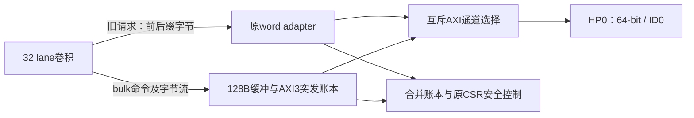

# S2C 32 lane中间版成段传输契约

日期：2026-10-30（UTC+8）。决策基线：`9c7cc242147b7d4875164a0a99c008f15610fd0b`。用户已选择先完成32 lane加突发中间版；原2fps目标继续保留，当前没有上板请求。

## ADR：保留旧事务完成语义，新增内部成段接口

现有`mem_ready`表示一笔旧32-bit逻辑事务已完成，runtime shell和network response槽都按此行为工作。把它改成写缓存入队确认，会影响错误、层切换及DONE语义。中间版因此保留旧word adapter与所有非卷积路径；新增独立bulk通道，只由冻结卷积候选使用。数学、地址空间、CSR、错误判据和SAFE要求不变。

相比直接修改旧adapter，新模块会增加少量选择逻辑，但保留可独立回归的旧路径。相比64-bit本地流，首版采用单字节本地数据流，可直接驱动现有特征/权重bank写口并保持约简顺序；每段只发一次地址命令和完成确认，不再每字节等待一次DDR事务。其本地搬运上限为1B/拍，不能用8B/拍载荷模型承诺整帧性能。后续宽写优化另行验证。

## 内部接口 s2c-bulk/0.1.0

所有握手均在时钟上升沿以`valid && ready`成立；有效且未握手的负载必须稳定。所有地址为既有逻辑字节地址，不是物理DDR地址。每次只有一个bulk命令；bulk与旧事务在物理AXI上互斥，沿用ID0。未连接的候选通道由默认关闭参数排除，不能因输入悬空而接收命令。

内部bulk通道的取消例外：cancel、run_enable撤销或已接受命令的epoch失配时，桥的cmd_ready/wready/rvalid/done_valid在该沿握手前即被抑制，取消优先，不产生内部接受。engine的abort可撤回尚未握手的内部cmd/W valid，桥可撤回尚未交付的R/完成valid，并丢弃对应本地缓冲；此例外只适用于内部bulk通道。物理AXI通道的VALID及负载仍须保持到握手，取消不能撤回它们。core的请求意图诊断需把bulk_cmd_valid计入，SAFE仍等待core STOP及合并账本。

| 方向（相对卷积） | 字段 | 语义 |
|---|---|---|
| 输出/输入 | `bulk_cmd_valid / bulk_cmd_ready` | 一次命令入队握手，不是完成确认 |
| 输出 | `bulk_cmd_write`、`bulk_cmd_addr[31:0]`、`bulk_cmd_bytes[7:0]` | 只接受8B对齐、长度8..128且为8倍数的连续段 |
| 输出/输入 | `bulk_wvalid / bulk_wready`、`bulk_wdata[7:0]` | 写段按地址递增发送恰好bytes个有效字节 |
| 输入/输出 | `bulk_rvalid / bulk_rready`、`bulk_rdata[7:0]` | 读段按地址递增交付恰好bytes个字节 |
| 输入/输出 | `bulk_done_valid / bulk_done_ready`、`bulk_done_error[2:0]` | 每个非取消命令一次最终完成；读字节交付结束或写AW/W/B全闭合后产生 |

旧接口处理不足8B的前缀/尾缀。bulk不越对象预取，也不用丢弃越界读数据来代替授权。命令可跨4KiB，物理桥在页界拆分，最多16个64-bit beat/AXI burst；同一命令仍必须完整落在同一个已授权对象内。

## 授权与物理事务

- `s2b_request_guard`新增对象物理begin/end输出（33bit、end exclusive），输出只在旧`request_allowed=1`时有效；对象表、旧准入结果和原端口语义不变。bounds来自该次命令已选字节命中的同一对象，不由后续输入重算。
- bulk准入调用同一对象表验证命令首字节及读写权限，再用33bit加法检查完整物理span不溢出、不超过对象exclusive end和原DDR窗口。写仍只允许feature对象。
- 参数/对齐/长度错误完成码1；范围错误完成码2；不发AXI请求。AXI SLVERR/DECERR通过原外层首错事件9/10处理，协议故障11，不能截断成3bit交给core。
- 准入拒绝可以在没有任何R字节、也未接收W payload时返回错误完成。engine在读/写数据等待阶段也必须能接受错误完成并结束为对应错误，不能等足N字节后才接收完成；正常完成若提前到达则按INTERNAL失败，不得报告成功。
- 物理读写均使用64-bit、SIZE=3、INCR、ID0，LEN=segment_beats-1。每段beat数取剩余beat和到4KiB页尾beat的较小者，命令最多128B，因此每个AXI段最多16beat。
- 写命令在声明AWVALID或WVALID之前必须收齐全部payload至128B缓冲。AW/W独立握手，WID=0，WLAST仅每个物理段末拍。写段仅在AW接受、全部W接受、B(ID0)接收三项齐备时闭合；B可晚于或早于AW完成，但必须对应已接受的全部W。
- 上述B早于AW接受是本目标AXI3的兼容情形，不能误套AXI4额外地址依赖；参见[Arm IHI0022H，A3.3通道依赖与Legacy considerations](https://developer.arm.com/-/media/Arm%20Developer%20Community/PDF/IHI0022H_amba_axi_protocol_spec.pdf)。桥即使先收到合法B，也要保持未接受AW及其负载，直到三项全闭合才完成。
- 读先收齐全部物理段，确认无响应错误，再向core交付字节；首版不边接R边交付部分结果。RREADY常1，缓冲足以容纳整个命令。每个R必须符合ID、准确beat数及RLAST位置。

## 取消、故障、epoch与SAFE

- `cold_reset`是唯一可以无条件丢弃物理账本的输入。`cancel`、run_enable撤销、epoch变化只停止新准入和core输出，不能撤销已声明VALID，也不能清除已接受物理责任。
- 写收集期尚未声明AXI时可取消本地缓冲。写一旦声明AW/W，全部数据已在桥内，取消后仍独立发送剩余W并等B；不能依赖已停止的engine继续供数据。
- 读取消后仍接受并排空已声明/接受AR的所有R，不交付数据或完成给旧epoch。未声明的后续页段可停止发起。
- 普通响应错误锁首错并继续排空；RID、BID、RLAST、unexpected response错误隔离。不能用错误响应证明原物理责任结束，也不能把协议隔离当可普通clear恢复。
- `ledger_empty`必须同时覆盖命令、收集/交付缓冲、响应、AR/AW/W声明及已接受等待、B等待；合并新旧ledger后才能供原CSR判定。保持epoch与first-fault/progress诊断含义，`ledger_empty_next`只作同沿诊断，不引入组合控制反馈。
- clear_safe只在run停、合并ledger空、无cancel/故障且未协议隔离时接受。协议隔离保持到统一冷初始化。取消丢弃本地数据不等于物理账本为空。
- runtime shell的数学任务与旧memory路径保留；bulk侧从network/backend经core新增内部端口传到top，不改变旧memory master语义。engine收到bulk最终完成后才能推进相应阶段/算子结果。

## 卷积分段与计数预测

权重按组的连续字节地址加载，bulk数据可跨lane边界，现有lane/reduction游标逐字节递增。特征按每通道有效行段读取，padding在本地写零，不把行间空洞拼入段。输出按NCHW通道行的连续x段发送；从已完成的output_block收集数据，只在B完成后确认该段写结束。

T66首层首16×16 Tile、32 lane仍需8192唯一输出黄金比较。对齐8B方案预测：特征96个32B命令/384 R beat；权重从逻辑offset0x13C开始，前后各4B走旧字节路径，中间856B为7个bulk命令/107 R beat；输出512个16B命令/1024 W beat。即615个bulk命令加8个旧byte命令，共623个地址请求、1523个AXI transfer beat，其中1515个SIZE=3的8B bulk beat及8个SIZE=0的旧字节beat，合计12128个有效逻辑字节。核对当前T66地址后这些段不需拆页；其他层若发生4KiB切分，必须另外计数并以实际地址复算，不能把本表当实测。

原32 lane首Tile52043 cycles只对应原单字节仿真后端。新测量须同时给bulk/legacy命令数、R/W beat、B数量、有效字节、padding、停顿和完整黄金对拍；不预设帧率。32 lane整帧纯算术106126592拍，100MHz也不能达到原2fps目标。

## 实施与验证边界

先独立验证bounds扩展和bulk物理桥，再完成engine、backend/core/top选择接入，最后运行同一黄金tile以及适用恢复回归、完整网络等价和100MHz综合。短仿真预计每组1–3分钟、低于1GiB；实际启动前再次预检。综合/实现另行报告时间/内存并单重型互斥。

协议测试必须覆盖8/128B、4KiB分段、对象尾部/越界、AW/W反压与独立接受、B晚到/先于AW闭合、cancel各阶段、epoch改变、SLVERR/DECERR、错误ID/RLAST、VALID负载稳定、clear互锁，以及旧word路径回归。随机测试保留seed和样本数。独立审查、commit_blob证据、真实退出码缺一不可；不以此文档代替实现或上板结论。
