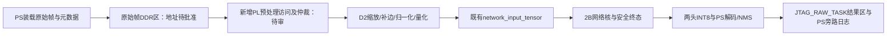

# ADR-S4B-PREPROC-01：原始帧到 PL 网络输入的 G0 准备

状态：`ARCHITECTURE_APPROVED / G0_NOT_READY`。日期：2026-10-23（UTC+8）。
Wong已在本会话批准§7路线进入受控开发及OOC资源/时序核验。本页不冻结新接口、地址、尺寸、指标或IP；位流构建和硬件执行仍须各自前置条件。

2026-10-25 格式决议：当前 RAW `raw_frame` 契约为 `pixel_format=BGR888`、像素通道顺序 B/G/R，平台 `byte_order=little` 独立表示多字节标量端序。冻结 D2 要求先逐像素 B/G/R→R/G/B，再 resize、归一化和量化。现有 C 注入描述符及 PL RAW 通道读取没有 BGR888 支持；源码也未找到 mailbox PS driver 或 `s4b_preproc_frame` 的 RTL 顶层实例。当前 C enum 数值 `1` 是 `RGB565`；下文 `mailbox_pixel_format_code=1` 是独立的 G0 候选 CSR 编码，候选映射为 `BGR888`，不是共享契约的字符串 `pixel_format`，不得直接 cast 到 C enum。该映射尚未由 PS driver 实现。契约运行期状态为 `NOT_IMPLEMENTED`、mailbox driver 为 `NOT_IMPLEMENTED`、PL 集成状态为 `NOT_INSTANTIATED`，在显式映射、顶层接入和验收完成前不得声称真实链路支持。

## 1. 当前可复用范围

- 2B 代码基线为 `16ce2cdf8c00c6214435629d75a5e4b63acb66a9`，含冻结证据的提交为 `07c3d3958578b9cc9d3b8eae3758711fe08724c2`。冻结 PS 应用将 519,168 B 的 CHW INT8 张量写入 `network_input_tensor`，通过自定义 HP0 word adapter 启动网络，输出 head13 5,070 B、head26 20,280 B，再在 PS 解码/NMS。
- 本次核对的冻结 2B 应用入口消费上述 CHW INT8 张量，没有原始 RGB 的 PL resize/letterbox 接入；几何逆映射函数不承担像素预处理。本页不据此断言未检查目录中的实现情况。
- PS 张量诊断应用的本轮任务范围计划仅复用上述网络/后处理入口，不承担 RGB 预处理；其实际实现、构建与独立审查另行绑定版本，不由本草案证明。
- 阶段3在 `D:\codex-worktrees\dbdf`，现有交付为灰度视频链路；所查 STATE、README 和 2B 冻结入口未找到视频与网络合并后的 XSA/地址图。此为限定检查结论。

## 2. 功能与数值约束

权威为现有 D2 规格和 `verification/s1_t02_d2_numeric_reference.py`，不是本页另定数值规则。

1. 模型目标沿用已冻结 tiny416，输出恰为 `[1,3,416,416]` CHW INT8。原图尺寸、stride 和格式仍由正式 G0 明确，不能据预算示例固定产品输入尺寸。
2. 保持宽高比，整数截断新尺寸，左上 padding 为 floor；端点对齐双线性，目标末行/末列及目标尺寸为1的取样按 D2 实现处理。
3. 当前 D2 先在 0..255 单位插值，再除255，补边归一化值为0.5，转CHW，以 scale=1/127、半数远离零和饱和规则量化。
4. 定点系数位宽、舍入位置和除法实现尚未选定。必须证明其最终 INT8 与冻结参考一致，特别检查恰好半量化边界；不能自行以“误差很小”替代逐值一致。
5. RAW 输入格式为 BGR888（像素通道 B/G/R），平台 `byte_order=little` 与通道顺序互相独立。必须逐像素 B/G/R→R/G/B 后才进入冻结 D2 resize/letterbox、归一化与量化；灰度只作诊断，不能用于冻结彩色 golden 的颜色/精度结论。当前仅离线 Python D2 图像参考路径执行该转换，C/PL 运行期支持缺失。
6. 输入长度、stride、末行/帧尾、地址加法和输出长度在启动前受检；无效参数不得启动总线事务。

### 已复现的量化边界反例

冻结 D2 的可观察结果还依赖 Python binary64 的逐操作舍入顺序，单写“精确有理数双线性、半数远离零”不足以复现它。合法源图 202×329、目标416×416，D2得到新尺寸255×416、offset=(80,0)。每行相邻首像素通道值为201、202时，输出坐标(81,0)的精确有理数缩放值为201/2，理想half-away量化为101；冻结D2实际scaled为 `0x1.91fffffffffffp+6`（100.49999999999999），最终INT8为100。127个构造半边界中20个存在同类差异；这不是对全部图像误差率的估计。

实验原脚本与结果已保留原字节于 `report/evidence/S4-B/s4b_pl_g0_numeric_20261023_r01/`，分别SHA-256 `e0fdaeb3fcf46be4164328facc58409f39b2d1067931672d2a89a32844f5af79`、`78a7337039b4e36e5c534fd15b21c9518277975f23b1fe07c1c8dd1b926abb37`，D2 SHA仍为 `6a3453d5bd60ab122c236667fbc9bcb5aa161d14b76bc7115b602743d5cbe54f`。独立Reviewer已复算该合法416反例。

建议保留现有D2结果：PL实现必须等价复现其运算和舍入，不能擅改为精确有理数或引入1 LSB容限。可评估共享多周期算术单元、受证明等价的整数实现等工程方案；尚无可信新增资源/最坏时延上界。若另选数值语义，须由Wong明确开启规格变更、独立审查并重建受影响参考/黄金，而不能沿用旧逐值验收结论。

## 3. 待审结构：DDR 原始帧、串行预处理与网络

- 候选首个闭环为单帧串行：预处理完成并排空全部写事务后，才启动网络。有限序列、多缓冲和显示读者在其接口就绪后另验所有权，不假定现有单帧容量能容纳双缓冲。
- 冻结 2B 没有 AMD AXI DMA IP。新增访问方接入 HP0 必须有明确仲裁与 AXI outstanding/排空证明，不能仅连接数据线就沿用原安全结论。
- 保留冻结网络核作为被消费的上游；新增预处理控制、版本与配置空间须单独审查，不能单方改写 2B 物理接口正文。
- 地址图 r04 当前候选为 `raw_frame`（BGR888、B/G/R）；`injection_frame_rgb` 是已由其取代的旧草案。`raw_frame` 仍未 FROZEN、`ENABLE=0`，显示区与部分 PS 工作区仍有未解析项。此页不将其变成可写地址。

### 单帧文件注入候选的具体改动

1. 当前 RAW 合约格式为 BGR888（字节 B/G/R），平台 `byte_order=little` 仅描述多字节标量端序。描述符/邮箱需携带帧ID、宽高、stride、格式、字节长度与 CRC；其实现目前不支持该格式，G-20 阻断运行期使用。尺寸/stride边界在G0依据输入清单选择，不在本页冻结产品范围。旧候选原帧区 `0x10700000..0x10B00000` 仅为草案4 MiB范围，未获准写入；当前 12 MiB `raw_frame` 仍 `ENABLE=0`。邮箱/控制区地址也待PS链接图、DDR所有权和重叠检查。
2. 保留 `s2bu/1.1` 字节协议正文及旧张量诊断路径。新增PS应用版本和独立原帧任务入口：冻结2B `RUN` 的CPU `memcpy(arena, staging+8, INPUT_BYTES)` 会覆盖PL预处理张量，因此原帧任务不能再调用该拷贝步骤。RAW任务由独立JTAG mailbox发起，不生成或伪造UART `RUN` 请求、UART sequence/frame或UART响应；它用mailbox的`session_id/frame_id/result_seq`和host `request_seq`关联。原CPU INT8 `RUN` 的真实UART请求/响应流程保持不变。
3. 候选在既有HP0单master之前增加单帧串行owner mux/任务相位；冻结 `s2b_request_guard.sv` 将对象0输入区设为只读，预处理写入必须受新增owner/范围资格约束。网络相位继续只读输入，预处理与网络不得同时发事务；各读写响应和ledger排空后才交接。`s2b_hp0_word_adapter` 的 `run_enable`、错误锁存与排空状态需同步版本化。此方案改变物理契约、XSA及PS应用，不能描述为零改动复用冻结2B。
4. 原 `prepare_cache()` 会在推理前flush输入区；原帧路径须证明PL写入前该区没有dirty cache，并避免PL写后将旧cache内容回写覆盖。PS写raw→flush+DSB→交出raw，PL写tensor→排空→交出tensor，网络读tensor→完成→PS invalidate heads的顺序须分别测试。
5. 4-D文件注入不合并阶段3视频XSA。旧2B上游冻结及证据保留，新增系统另建版本/证据并进行受影响网络回归；摄像头路径在其依赖就绪后另验。

### 备选路径与代价

| 候选 | 优点 | 需解决的问题 |
|---|---|---|
| DDR读帧后预处理 | 文件注入可控，输入CRC/逐值对拍方便，适合先单帧闭环 | 新访存方、仲裁、输入/输出所有权及总线排空；增加DDR流量 |
| 摄像头流直接预处理 | 有机会减少完整原始帧读回 | 依赖阶段3真彩、AXIS背压/CDC及帧关联；文件注入也需要真实入口，当前无合并设计证据 |

Wong已批准先推进上述DDR路线的受控开发及OOC评估。部署和完整阶段依赖仍须分别闭合。

## 4. 同一 R04 设计的资源事实

报告目标：`xc7z020clg400-2`、`s2b_inference_wrapper`、Routed、50 MHz；用户标称器件及实板对应限制沿用冻结回执。

| 资源 | 已用 | 总量 | 算术余量 |
|---|---:|---:|---:|
| Slice LUT | 17,250 | 53,200 | 35,950 |
| Slice FF | 4,246 | 106,400 | 102,154 |
| DSP48E1 | 145 | 220 | 75 |
| Block RAM Tile / RAMB36 | 32 | 140 | 108 |

RAMB18=0/280，不能与 RAMB36 Tile 重复相加。R04 setup WNS=+0.156 ns、hold WHS=+0.078 ns，TNS/THS=0；该余量不证明新增模块还能满足时序。

证据位于 `D:\FPGA_Competition\w2b\report\evidence\S2B-T19\visibility1_csr_fixed_20261016_r04\artifacts\`：

- `utilization.rpt` SHA-256 `71eebb1f90558d176b9509d5e0bcfeb9162073ea4e6bc934eee00bd98e50f63a`，行35/40/106/120。
- `timing_summary.rpt` SHA-256 `15bbc671bde91b7ec92ae58249051bc7ed4e8e6dc3734a39a4f4c79762fcd99c`，行141/154/215/216。
- 报告哈希与同次 `input_record.json` 自洽。外层冻结清单绑定 R04 bit/XSA，没有逐项收录这些报告；不把这两种绑定强度混同。
- 不把阶段3另一设计的资源与本表相加后声称合并设计通过。视频旧工程目标与 R04 标称不同，合并目标及约束需在 G0 核实。

### 尚未完成的增量预算

1280×720 BGR888 仅作为现有草案的 24-bit 容量预算场景：原始帧 2,764,800 B，输出张量 519,168 B。若选两条原始 BGR 行缓存，纯数据容量为 `2×1280×3=7,680 B`（61,440 bit）。这只是存储量计算，不是实际 BRAM 个数；端口、分银行、插值中间位宽和控制还需计入。

新增 LUT/FF/DSP/BRAM、DDR事务量、最坏背压、时钟/复位/CDC、布线后的时序和吞吐均未验证。原始帧区容量不等于可用带宽。完整增量预算和接口审查完成前，G0 仍未就绪。

上述1280×720算例每次包含原帧读2,764,800 B、张量写519,168 B、网络输入读519,168 B，共3,803,136 B；未计权重、feature、heads与总线开销。这是payload流量估计，不能由HP0名义线速推出实际带宽或期限。输入图尺寸、最坏服务时间与性能标准仍待G0核实，本候选不提出新的FPS门槛。

### 冻结样本的实际原帧容量约束（2026-10-23补核）

已按S4-A的精确路径与SHA复核 `fixed_test_samples.json`（93,708 B，`ccf741c1e996c72b985ce1dcbd399c5184347c922d286a8c0250ef5f6a755eed`）。其中105张JPEG/PNG、4张合成RGB416。以下只按解码后紧密排列的 `width×height×3` 计算，未读取原图，未计stride对齐或控制区：

| 项目 | 结果 |
|---|---:|
| 样本数 | 109 |
| 最小单帧24-bit RAW（BGR888 目标格式） | 519,168 B |
| 最大单帧24-bit RAW（1920×1920，BGR888 目标格式） | 11,059,200 B |
| 超过4 MiB | 97帧 |
| 超过8 MiB | 2帧 |
| 不超过4 MiB | 12帧 |
| 不超过8 MiB | 107帧 |

因此，`0x10700000..0x10B00000` 这个**半开区间**候选只有4 MiB，无法容纳至少100帧的冻结输入覆盖，不能沿用为4-D的已定原帧区。建议继续按默认109帧完整覆盖预算单帧容量，至少覆盖11,059,200 B，再计stride、对齐及控制开销，并重新核对DDR实际映射、网络/feature/PS/显示区及所有权；本页不批准扩容地址。

CDX-20261022-010 §5要求至少100帧实际网络预处理张量对独立PC参考，默认golden为109冻结样本，并非强制109帧全部作为raw输入。若另选子集，必须预先冻结样本ID和覆盖约束；不能取任意新场景对旧golden，不能因4 MiB草案不足而静默减样本求通过。≤8 MiB的107帧仍包含五类、3负样本、2 multibox及4合成，但不包含两张1920×1920的two_up样本，不能声称完整保留每类前20张。

容量复核及逐样本超限列表见 `report/evidence/S4-B/s4b_pl_g0_input_scope_20261023_r01/input_scope_audit.json`。旧模型manifest所绑D2 SHA为 `ea48281fa1c1ba14006f6131ff377c7e4523da8c7e4977b0949d454a7c9ded90`，本树为前述 `6a3453...b54f`；二者UTF-8文本逐行完全相同，长度差402 B仅来自LF/CRLF，不能将原字节哈希差误报为数值算法变更。此前容量/34向量桥接阶段没有重生成109帧D2；旧证据保持当时范围。后续109帧CPU参考重生见下一段，整帧PL入口仍未接通、尚无实物raw对拍。

独立合成桥接已在绑定源码中仅提取纯函数和必要常量：34个向量（含seed=20261023的24个随机向量）逐元素一致；202×329半边界的三个通道两路均为100。该结果只支持所测向量，不代表109原图重生成、跨平台形式证明或新PL通过。原始脚本、AST提取清单及结果保全于 `report/evidence/S4-B/s4b_pl_g0_reference_bridge_20261023_r01/`；结果SHA-256为 `4922ba534e5d19f72e301901cc69007278c0ca2e8096ffde7f8368b52d6816a7`。实验曾误落主目录的本轮临时区，已逐文件SHA保全到本树并只删除六份自有副本及三个空目录，恢复记录在该包内；历史命令中的原路径不作为后续写入入口，复现必须使用本树新的绝对RunId。

后续独立运行 `s4b_raw_reference_109_20261023_r01` 已核对105张原图SHA、4个冻结合成RGB摘要，并直接调用冻结标量D2重生成全部109个CHW INT8张量：109/109摘要与旧冻结样本一致，native exit 0，耗时190.075秒。RAW共808,263,072 B，参考张量共56,589,312 B；原始脚本、执行参数、进度、结果及本地输入SHA清单保全于 `report/evidence/S4-B/s4b_raw_reference_109_20261023_r01/`。本次OpenCV 4.13.0、NumPy 2.4.6；RAW与参考仅作后续PL对拍的可重建本地输入，不入源码Git，恢复与限制见该包的 `storage_policy.json`。这证明本次CPU参考与冻结输入一致，不代表PL张量、网络heads、板测或4-D通过。

## 5. 非功能与故障语义

- 正确性：逐字节输出与冻结 D2 独立参考比较，保留种子、输入SHA和误差位置；不得改参考或放宽容限求PASS。
- 时序/性能：报告预处理、网络、PS后处理和传输各自区间；正式吞吐/期限及跨域换算待批准，不采用废弃20FPS或200ms草案作为已批准指标。
- 所有权：PS写完flush+DSB后发布；预处理写输出后需真实完成/排空，再由网络读取；PS读heads须done后invalidate+DSB。
- 恢复：预处理超时不表示其AXI事务结束。未知pending、部分帧、重复/乱序、CRC错误均保留证据，不能复用仍被持有的区间或把超时当零框。
- 可复现：同一输入/系数/模型/工具/源文件和bit/XSA/ELF分别绑定，不改写旧RunId；新位流须形成独立证据。
- 操作安全：限制写入已批准半开区间，校验乘加溢出；正式硬件授权和会话交接后才装载/启动，不接管其他阶段会话。

## 6. G0关闭条件及后续验收

| 关口 | 必须补齐 |
|---|---|
| 数值G0 | 支持的源格式/尺寸/stride，系数与中间位宽，D2逐值一致性依据和边界向量 |
| 系统G0 | 目标器件/约束，CSR/DDR/AXI/时钟复位接口，地址与所有权，完整增量资源和带宽预算，Wong架构决策 |
| 开发与审查 | 新模块/驱动的独立反例与回归，版本冻结后的独立Reviewer结论 |
| 注入实物 | 正式授权与会话交接，至少100帧预处理张量及heads/逐框分层比对，≥30分钟且≥1000次有效推理、故障恢复 |
| 摄像头与阶段 | 阶段3真彩依赖，真实采集回归、独立精度与正式指标；不能用诊断张量入口代替阶段G5 |

重大架构决策须由 Wong 决定，依据本项目 `AGENTS.md`“基本约定与授权边界”；新增 IP 另须按 CDX-20261022-010 §3 第3项完成资源预算和接口审查。本页的预算事实和候选结构不替代架构批准或上述审查。

## 7. Wong已批准的路线范围（2026-10-23）

本会话异步决策问题完整引用了下列路线及保留条件，Wong答复为“批准按此路线推进（推荐）”。随后要求继续任务，并告知板卡已上电和连接。该现场告知尚不证明当前会话归属、装载版本或任何板测结果。

- 数值语义：建议保持冻结D2逐值结果；另一选项是正式开启数值规范变更，后者须重建受影响的验收依据。
- 已批准架构范围：上述“独立PS/JTAG原帧任务入口、单帧串行HP0所有权、PL预处理写网络输入、新PS入口跳过CPU tensor拷贝”的新版本路线进入受控开发及OOC资源/时序核验；不合并阶段3视频设计。
- 首轮输入范围：RAW 文件按 BGR888 输入（每像素 B/G/R），D2 前执行通道重排；具体尺寸/stride边界由现有样本与容量核对后形成G0范围；地址和邮箱布局、增量资源/时序结果、所有权接口与适用性能标准仍须工程核验和独立审查。

批准评估范围不表示G0/G1/G2或4-D通过。未完成实际命令实现和审查、硬件会话接管、版本与授权绑定前，不加载位流或执行板上任务。

## 8. 系统接口 G0 补充规格（2026-10-23；待独立 G0 审查）

本节把已批准路线具体化为接口规格候选，供独立 Reviewer 完成接口 G0 审查。路线无需再次申请 Wong 批准；接口审查通过后，可按参数化抽象地址继续离线开发 RTL/driver。当前物理 DDR 集成仍为 `BLOCKED`：地址未闭合时，生产 RAW/META 基址参数必须保持未绑定且 `ENABLE=0`，不得访问候选物理区或运行硬件。实现代码的独立审查属于后续 G2，不是开始离线实现的前置条件。

### 8.1 冻结依赖与最小集成单元

只消费冻结 2B 网络和 PS 后处理，不在 `w2b` 原树上修改。受控 S4B 集成从审计绑定的冻结 Git 源恢复缺失的 12 个 RTL 依赖模块，再建立新的 source snapshot、wrapper、BD/XSA、PS 应用与测试证据。上游审计 `tmp/4/S4B-PL-INTEGRATION-BASIS/source_audit_20261023_r01/result.json` SHA-256 为 `93c3de528784e78eb4fad698db064364c7ed94fab2c0ace5d2c99417b1d06c70`：26 个 R04 文件与实际 `w2b` 源一致，25 个 Git blob 字节匹配；`s2a_network_descriptor_pkg.sv` 仅 CRLF/LF 差异，经 EOL 等价核查 SHA-256 `0b9c84e64330402704d917689e3fead2ece0692ef977abf029fbfa5addd396b5`。这只证明源绑定，不复活 R04 的旧 synthesis/board 结果，也不证明新 wrapper。

从冻结提交 `07c3d3958578b9cc9d3b8eae3758711fe08724c2` 完成了隔离恢复准备：26 个文件经 Git object 提取并逐项 SHA 匹配，恢复到 `D:\codex-worktrees\w4\tmp\4\S4B-PL-INTEGRATION-BASIS\network_recovery_20261023_r01\source_snapshot\`，总计 1,342,054 B；`recovery_manifest.json` SHA-256 为 `9f5b4241cc0c6a130935bfe891285c0efe87da0c507ab38a60ded49c3becf559`。该步骤只写入新临时快照，未修改活动 S4B RTL、`w2b` 或执行综合；后续受控 derived top 可从该快照派生，不能把隔离恢复准备说成已完成集成。

关键冻结 RTL / BD 脚本 SHA-256：

| 输入 | SHA-256 |
|---|---|
| `w2b/src/s2b_inference_top.sv` | `dffd20728b6a3b88c9c4a0c63987e10460a54728f5e348ccf1f8182e78c859c1` |
| `w2b/src/s2b_control_csr.sv` | `4beaad995d31835799a20138ed027125fbb4920795d64e471c6174ced12169d1` |
| `w2b/src/s2b_hp0_word_adapter.sv` | `344f5553da157434039ec531ccef83cd74dba9c67533a0b88642438e5b5a8f62` |
| `w2b/src/s2b_request_guard.sv` | `b09d8bddd60775efe49857b2ea837031db75c0fb802ace6075a3364da9d24531` |
| `w2b/vivado/s2b_inference_platform.tcl` | `700a02ff3e6f515e3f53a90d17abde2fd3be3ed9c85e928887a54f0652d86949` |

最小新系统顶层建议为 `s4b_preproc_inference_wrapper`，仅含下列四个新边界模块：

1. `s4b_preproc_controller`：单帧命令、D2 顺序控制、完成/错误状态及 session/frame 锁存。
2. `s4b_preproc_hp0_master`：读取 RAW 与几何表、写入网络 tensor 的新 AXI3 单拍 master；独立检查边界和 read/write ledger。
3. `s4b_hp0_owner_mux`：复用唯一 PS7 `S_AXI_HP0` 物理端口，在冻结网络 master 与预处理 master 之间按显式 owner 锁存切换。
4. `s4b_axil_router`：保持旧 CSR 地址/响应语义，为新寄存器区解码，并把 network START 准入与 owner 状态互锁。

`s2b_inference_top` 及其控制器仅在受控快照内做最小的可观察信号扩展：须将 CSR 接受 START 的单周期事件、精确状态 `IDLE_PS`、`core_mem_valid`、adapter 的 `ledger_empty`/`ledger_empty_next`、`protocol_isolated`、故障/恢复状态和物理 master 请求有效信号安全地送到 wrapper。冻结 top 当前注释明确称其不读取核心内部状态，这些安全信号目前没有公开；不得通过读取综合层级内部网名或只观察 HP0 空闲来代替接口。旧 `s2b_request_guard` 继续保护网络对象范围；新 master 单独实现只读 RAW/几何范围和只写 tensor 范围，不放宽旧 adapter 的输入只读规则。

BD 从现有 `s2b_inference_platform.tcl` 派生受控 S4B 脚本：PS7 `M_AXI_GP0` → 现有 `axi_protocol_converter`（AXI3 32-bit 至 AXI4-Lite 32-bit）→ wrapper `S_AXI`；wrapper 单一 AXI3 32-bit 地址/64-bit 数据/6-bit ID HP0 master → PS7 `S_AXI_HP0`。控制窗口维持物理 `0x43C00000..0x43C10000`；旧 CSR `0x000..0x074` 与诊断 `0x100..0x13c` 的读写行为不变；新块仅占 `0x200..0x27c`。FCLK0 为 50 MHz，GP0、HP0、wrapper、两 master 与新控制逻辑使用同一 FCLK0，沿用共同冷复位/`proc_sys_reset`；不增加时钟域、AXI DMA 或其他 AMD IP，不合并阶段 3 视频 XSA。BD validate、地址映射、clock/reset 拓扑和实际包装顶层独立审查后才可创建新 XSA。

为了允许地址审计期间继续做离线工作，`s4b_preproc_frame` 可使用参数化 416×416 输出与 generic 单 outstanding 64-bit word 请求/响应接口（该接口不是 AXI，不含实体 CSR 或生产物理基址）；单元从 start shadow 原子锁存 source width/height/stride/storage、new dimensions/pad、RAW/X/Y geometry/TENSOR 抽象基址，先装入各 416×24 B 轴表，再按 D2 顺序写 CHW INT8，每拍 8 B。仿真仅通过 test memory 抽象地址访问。后续 HP0 word master、AXI-Lite wrapper/BD 与真实基址属于系统集成工作；物理地址未批时不得把候选地址编入 RTL/driver 默认值。

### 8.2 DDR 区域、样本范围和打包

109 帧冻结样本清单为 `D:\codex-worktrees\w4\report\evidence\S2A-T01\fixed_test_samples.json`，SHA-256 `ccf741c1e996c72b985ce1dcbd399c5184347c922d286a8c0250ef5f6a755eed`。首轮 4-D 只允许该清单内已绑定的样本 ID/宽高；拒绝清单外的新尺寸，直至输入范围另行评审。raw_frame 目标格式为 BGR888、逐像素字节顺序 B/G/R；首轮 stride 固定为 `width*3`，`logical_bytes=stride*height`。既有 109 RAW/direct-D2 容量证据只绑定三字节长度，不能证明 BGR 通道支持。每帧独占一个 RAW 缓冲，不做双缓冲；这只限定复现语料，不冻结后续产品尺寸。

| 区域 | 建议半开区间 / 长度 | 含义及约束 |
|---|---|---|
| RAW | `[0x12000000,0x12C00000)`，12 MiB（BLOCKED） | 单帧紧密 BGR888（B/G/R）；`byte_order=little` 独立描述平台标量端序；`storage_bytes=align_up(logical_bytes,8)`；host 将逻辑末尾至 storage 末尾写成零，PS 在 COMMIT 校验，PL 不把尾部当像素。最大语料帧 11,059,200 B，区内算术余量 1,523,712 B。 |
| mailbox / geometry | `[0x12C00000,0x12C08000)`，32 KiB | CPU/JTAG descriptor、ACK、几何表及固定 JTAG_RAW_TASK 结果区；PS/host 管理缓存，PL 对有效几何表只读。 |
| frozen input tensor | `[0x10000000,0x1007EC00)`，519,168 B | PL 只写；网络 master 只读；PS 在 PL 完成前不读写。边界与本次地址图一致。 |

**上述 RAW 与 metadata 地址均为 `BLOCKED` 候选。** 当前 `S4B_stage4_address_map.json` SHA-256 `80104b8031f86f8cf1653bc5efdc542d11519cebcae073b5f9ea747b0ed2046a` 明确禁止访问 `[0x12000000,0x20000000)`。现有 PS 诊断应用 r13 的实际 `.map` SHA-256 为 `4a0f9cf8e281482a70459f5e247c9b42863bff058b91c38eb7fcf832fcc1d62d`；其配套 `memory_ranges.json` SHA-256 为 `5a53c214e4f3862d071016b64b182463e07c4c4877305bb196ef8f0af3889c80`，显示该诊断 ELF 的 `ps_app_arena=[0x00100000,0x01100000)`，其中 staging 为 `[0x00150440,0x006f173c)`、BSS/heap/stack 分别覆盖到 `0x0082fed0`；其 `.s2b_tensor_ddr` 为 `[0x10000000,0x12000000)`（32 MiB），网络输入张量为 `[0x10000000,0x1007ec00)`。这是诊断 ELF 的分配事实，不证明其他 PS 固件、PL master、视频 DMA 或板级保留区在候选范围内为空，也不授予候选区所有权。

只读工程审计 `report/evidence/S4-B/s4b_pl_ddr_g0_audit_20261023_r01/` 已把候选冲突检查推进到独立 G0 复核候选：所选实际输入绑定的 frozen XSA 为 `D:\FPGA_Competition\w2b\report\evidence\S2B-T19\visibility1_csr_fixed_20261016_r04\artifacts\s2b_inference.xsa`（SHA-256 `ea52da1b143f15331a42ea8bdd27578f5d814368f77d7b779f7fa650f5cb0eb6`）；其 BSP DDR 软件窗口为 `[0x00100000,0x40000000)`，当前 S4B 地址图建模 `[0x00000000,0x20000000)`，候选 RAW/META 均在两者交集内。r13 PS app arena `[0x00100000,0x01100000)`、tensor arena `[0x10000000,0x12000000)` 与候选不重叠，RAW 起点正邻接 tensor arena 半开区间末端。W5/Stage3 历史三个 framebuffer 分别为 `[0x00114C00,0x003B7C00)`、`[0x00703800,0x009A6800)`、`[0x00CF2400,0x00F95400)`，均与候选不重叠；历史地址依据 W5 P1 run manifest 与只读 buffer readback 日志交叉绑定，匹配的最终 P1 ELF/map 未保留；已批准路线不同时加载 Stage3/video XSA。审计没有发现已列 owner 的地址冲突。地址图中的 `[0x12000000,0x20000000)` 是现行范围/准入禁区，没有证据表明该跨度已登记为具体占用 owner；不能因此推断它已被占用，也不能在禁区解除前访问。此交叉审计尚待独立 G0 审查，且假设没有其他 DDR consumers、CPU1 保持停止、未来硬件会话独占；XSA 静态配置和历史 buffer 读数不证明当前板载 DDR 解码、实装容量、当前加载平台或实时所有权。审查通过后仍需登记 RAW/META owner 并更新地址图以解除 blocked；此前物理访问继续禁用。

Mailbox 候选内部偏移（均相对候选 metadata base；外部地址仍禁用）：`HOST_REQ +0x0000..+0x007f`（128 B）、`PS_ACK +0x0080..+0x00bf`（64 B）、`PS_GEOM +0x00c0..+0x00ff`（64 B）、`PS_RESULT +0x0100..+0x013f`（64 B）、X 表 `+0x0140..+0x283f`、Y 表 `+0x2840..+0x4f3f`，JTAG RAW 结果数据区固定为 `[+0x4f40,+0x8000)`（12,480 B）。结果区起始处仅写有效的 metadata 与检测框字节，余下空间初始化为零。X/Y 各固定 416 个 24 B entry，总表长 `2*416*24=19,968 B`；entry 小端编码 `u32 i0, u32 i1, u64 w0_bits, u64 w1_bits`。有效 entry 按各自 `new_width/new_height` 排列，轴表未使用尾项必须全零。几何 schema version=`1`。PL 消费 binary64 原始位型并严格遵循 D2 每步乘加顺序，禁止定点化、重排、FMA 或改舍入规则。

上述表格式的算法来源已 G2 PASS：`e1e79fcfcedd653681336e45c323de6ba3ed5558` 固定 `r03` 的两源快照 `report/evidence/S4-B/s4b_pl_geometry_g2_20261023_r03/frozen_sources.json`（SHA-256 `bd68ba6f18ffb335898539254b2ebf80e78ed1beea988d5ff829dae9346669e8`）；来源为 `build_s4b_preproc_geometry.py` 与其测试，两文件 SHA 分别是 `71f344b713c30784af4e0db0dd2669b5f07b36927f160fe6964ffe7c5607244a` 与 `db1d239c1b4674ed1b46eb869a9dcab86d606f42edbeb263fba95cd13ea8347c`。这冻结几何生成算法及 binary64 字段语义；本节定义的 mailbox 二进制映射与 PS/PL 消费仍属于待审新接口。

PS 通过 64 B 外对齐的行维护缓存边界；AXI master 每次物理访问限定在上述获批半开区间，地址 8 B 对齐、单拍 8 B。RAW 最后一拍只可覆盖 `storage_bytes` 内的逻辑+零 pad；张量写必须完整覆盖且仅覆盖 519,168 B（64,896 个 8 B word，`WSTRB=0xff`）。几何表地址、长度和索引在开始前检查加法溢出、范围、对齐、输入尺寸以及 source index 小于宽/高；任一失败不产生 AXI 请求。原始图像所有权、PS/JTAG/DAP cache 属性及 DAP 写入可见性需在集成测试实测，不能从地址存在推出一致性。

### 8.3 JTAG mailbox 与 PS 所有权顺序

JTAG 描述符/RAW task 独立于 UART `s2bu/1.1` 正文。固定 UART `RUN` 仍为 8 B timeout + 519,168 B INT8 tensor；不能把 RAW RGB 塞进该 payload，也不能在 PL 输出后调用旧 `memcpy(arena, staging+8, INPUT_BYTES)` 覆盖 tensor。新增 PS RAW task 对通过逐字节 D2 对拍的 PL tensor 调用目标入口 `infer_one_from_pl_tensor()`，复用冻结网络启动、heads 读取和 T62/T29 解码/NMS，只跳过 CPU tensor memcpy 和会覆盖 PL 输出的 input cache writeback；保留 weights clean/flush、feature flush+invalidate、head 输出 invalidate+DSB。RAW任务不调用 UART `send_response()`、不构造 `s2bu/1.1` header，也不填写虚构的 UART request sequence/frame/repeat 字段；它在固定 metadata 结果区发布 `JTAG_RAW_TASK` 数据，由 `PS_RESULT` 描述符引用。原 CPU INT8 `RUN` 的真实UART响应流程保持不变。旁路日志用 S4-A 既定 `(session_id, frame_id, result_seq)` 关联，并额外记 host `request_seq` 与样本 ID。

JTAG RAW 结果数据块复用 S4-B 现有 40 B `s4_uart_meta_pack()` 字段布局及 48 B `s4_uart_box_pack()` 框布局，但本块不是 UART 帧或 S2BU 响应：不含 S2BU header、op、UART sequence/frame/repeat 语义。40 B metadata 按现有 `<Q8I>` little-endian 顺序保存：`epoch@0x00`（实际网络 epoch）、`phys_status@0x08`、`error_code@0x0c`、`last_reject@0x10`（实际 terminal snapshot）、`raw_candidate_count@0x14` 和最终 `box_count@0x18`（冻结 T62/T29 输出），`repeat_index@0x1c/repeat_total@0x20` 写 0 且 host 不解释这两个 UART 专用字段，成功发布时 `response_code@0x24=0`。其后紧接 `box_count` 个 little-endian `<ii5d>` 条目，分别为 `class_id`、`source_order`、binary64 `score/x1/y1/x2/y2`；按 `s4_uart_box_pack()` 逐字段写出，不 memcpy C struct。`box_count` 必须等于 frozen `S4_MAX_OUTPUTS` 上限内的实际输出数，`0..15`；`raw_candidate_count` 保持冻结口径（阈值后、排序截断前、NMS前），不与输出框数混用。有效数据长度严格为 `40+48*box_count`（最大 760 B），框坐标沿用解码器裁剪后的归一化原图 xyxy。没有有效检测时保留 `box_count=0`，共享 S4-A 状态可从既有字段派生 `NO_HAND`，不另造分类值。

`session_id` 在线路与 S4-A/shared contract 中始终是 u32；不与 `boot_seed` 拼接或扩成 u64。若 PS 实现为跨启动生成新非零 session 而使用内部 u64 boot seed，须把它单独留在 PS 本地启动元数据/旁路日志中，不能改变 mailbox 字段或 session_id 的位宽/语义。

所有 record 字段为小端固定宽度。协议版本均为 `1`；HOST_REQ `record_bytes=128`，其余三种 record `record_bytes=64`。ASCII magic 按内存字节逐字节写入，若作 little-endian u32 解释，数值分别是：`S4BR=0x52423453`、`S4BA=0x41423453`、`S4BG=0x47423453`、`S4BS=0x53423453`。G0 候选 RAW 编码字段名为 `mailbox_pixel_format_code`，候选值 `1` 单独映射至共享契约字符串 `pixel_format=BGR888`（像素字节 B/G/R）；descriptor 其他字段仍使用小端标量端序。此候选字段不是 C `s4_inject_pixel_format` enum：现有 C enum 值 `1` 是 `S4_FMT_RGB565`，禁止直接 cast；目前无 PS mailbox driver 实现映射，也无 `s4b_preproc_frame` RTL 顶层实例。该编码仅待独立审查，不代表 C/PL 已支持。geometry schema version=`1`。CRC 固定为 CRC-32/ISO-HDLC（反射多项式 `0xEDB88320`，初值/最终异或 `0xffffffff`，与 Python `zlib.crc32` 相同）。HOST_REQ、PS_ACK、PS_GEOM、PS_RESULT 的 CRC 字段各自只校验本 record；几何表 CRC 只校验 19,968 B 表体，顺序为完整 X 表后完整 Y 表。所有 reserved 均必须写零并由接收方检查。

opcode 3 的 `result_record_crc32@0x54` 必须等于上一条 PS_RESULT 的 `record_crc32@0x38`；它不替代 HOST_REQ 自身的 `descriptor_crc32@0x70`。所有未分配字段均写零并由接收方检查。

128 B `HOST_REQ` 布局。descriptor CRC 覆盖全 `[0x00,0x80)`，计算时把 `descriptor_crc32@0x70` 和 `commit_seq@0x7c` 都置零：

| 偏移 | 类型 | 字段与精确语义 |
|---:|---|---|
| `0x00` | u32 | magic `0x52423453`（ASCII `S4BR`）。 |
| `0x04` | u16/u16 | `version=1` / `record_bytes=128`。 |
| `0x08` | u32 | opcode：`1=RAW_BEGIN`、`2=COMMIT`、`3=RESULT_CONSUMED`。opcode 3 仅确认 host 已完整读取并验证本帧 PS_RESULT，不启动 PL。 |
| `0x0c` | u32 | host `request_seq`，从 1 起单调递增；本 host session 不回绕、不复用。 |
| `0x10` | u32 | `session_id`；RAW_BEGIN 为 0 表示开启新会话（首次启动且无未完成终态可直接初始化；后续须前帧结果已确认消费或错误已安全确认，且 owner/ledger 无 pending）；非 0 必须回显当前活动会话。COMMIT/RESULT_CONSUMED 必须回显 PS 分配的 u32。PS 不分配 0，u32 耗尽即拒绝新会话，禁止回绕或复用。 |
| `0x14` | u32 | `frame_id`；RAW_BEGIN 必须为 0，表示请求 PS 在该 session 内分配下一个 u32；COMMIT 与 RESULT_CONSUMED 回显 RAW_GRANTED/PS_RESULT 中的 PS u32。 |
| `0x18/1c/20` | 3×u32 | 原图 `width/height/stride_bytes`；RAW_BEGIN/COMMIT 有效且 stride=`width*3`，RESULT_CONSUMED 全为 0。 |
| `0x24` | u32 | `mailbox_pixel_format_code=1`（G0 候选值，显式映射到共享契约字符串 `pixel_format=BGR888`，逐像素 B/G/R）；与 C enum 编码域分离，C enum 值 `1` 是 RGB565；无 PS driver 映射实现、禁止直接 cast；当前 RTL 无顶层实例。RESULT_CONSUMED 为 0。 |
| `0x28/2c` | 2×u32 | `logical_bytes/storage_bytes`；RAW_BEGIN/COMMIT 有效且后者严格为 `align_up(logical_bytes,8)`，RESULT_CONSUMED 为 0。 |
| `0x30` | u32 | RAW_BEGIN/COMMIT 为 `raw_crc32`（logical bytes CRC，不含末尾零 pad）；RESULT_CONSUMED 为 0。 |
| `0x34/38/3c/40/44` | 5×u32 | `geometry_version/new_width/new_height/pad_left/pad_top`；RAW_BEGIN/RESULT_CONSUMED 全为 0，COMMIT 为 host 生成的 D2 geometry。 |
| `0x48` | u32 | `geometry_bytes`；RAW_BEGIN/RESULT_CONSUMED 为 0，COMMIT 固定 19,968。 |
| `0x4c` | u32 | `geometry_table_crc32`；RAW_BEGIN、RESULT_CONSUMED 为 0，COMMIT 覆盖完整 X||Y packed table。 |
| `0x50` | u32 | opcode 3 专用 `result_seq`，精确回显已读 PS_RESULT；其他 opcode 为 reserved=0。 |
| `0x54` | u32 | opcode 3 专用 `result_record_crc32`，精确回显该 PS_RESULT 的 `record_crc32@0x38`；其他 opcode 为 reserved=0。 |
| `0x58..0x6c` | 6×u32 | reserved，必须为 0。 |
| `0x70` | u32 | `descriptor_crc32`。 |
| `0x74/78` | 2×u32 | reserved，必须为 0。 |
| `0x7c` | u32 | `commit_seq`；descriptor 其余字节先写完，最后以一次对齐 32-bit DAP store 发布，必须等于 `request_seq`。 |

64 B `PS_ACK` 布局。ACK CRC 覆盖全 64 B，计算时将 `ack_crc32@0x38` 和末尾 `ack_seq@0x3c` 置零；`descriptor_crc32` 始终表示本 ACK 确认的 HOST_REQ descriptor CRC，不随 phase 改义：

| 偏移 | 类型 | 字段与精确语义 |
|---:|---|---|
| `0x00` | u32 | magic `0x41423453`（ASCII `S4BA`）。 |
| `0x04` | u16/u16 | `version=1` / `record_bytes=64`。 |
| `0x08/0c` | 2×u32 | 对应 host `request_seq` / opcode。 |
| `0x10/14` | 2×u32 | PS 分配的 `session_id` / `frame_id`，均为 u32。 |
| `0x18` | u32 | phase：`0=READY_FOR_BEGIN`、`1=RAW_GRANTED`、`2=COMMIT_ACCEPTED`、`3=TENSOR_READY`、`4=NETWORK_STARTED`、`5=DONE`、`6=REJECTED`、`7=DRAINING`、`8=ERROR_SAFE`、`9=FAULT_ISOLATED`、`10=RESULT_CONSUMED`。READY 时 session/frame 为 0。 |
| `0x1c` | u32 | `error_code`：`0=NONE`、`1=BAD_DESCRIPTOR`、`2=BAD_SEQUENCE_OR_ID`、`3=BAD_RANGE_OR_LENGTH`、`4=BAD_RAW_CRC_OR_PAD`、`5=BAD_GEOMETRY`、`6=OWNER_BUSY_OR_STATE`、`7=AXI_RESPONSE_ERROR`、`8=DRAIN_TIMEOUT_ISOLATED`、`9=BAD_RESULT_ACK`。 |
| `0x20/24` | 2×u32 | `active_raw_base/storage_bytes`；地址未批准或路径 disabled 时均返回 0。 |
| `0x28/2c` | 2×u32 | PS timer 的 `raw_begin_tick_lo/hi`；PS 在 RAW_GRANTED 前采样，后续 ACK 原样回显。 |
| `0x30` | u32 | `descriptor_crc32`，始终是已确认 HOST_REQ descriptor 的 CRC；READY_FOR_BEGIN 为 0。 |
| `0x34` | u32 | `timer_freq_hz`，来自 PS 同一单调计时器；RAW_GRANTED 与后续 phase 回显，READY_FOR_BEGIN 为 0。 |
| `0x38` | u32 | `ack_crc32`。 |
| `0x3c` | u32 | `ack_seq`；每次 ACK 先清零并 clean+DSB，写入全 record/CRC 后 clean+DSB，最后写 `ack_seq=request_seq` 并 clean+DSB。初始 READY_FOR_BEGIN 使用 `request_seq=ack_seq=0`，由 phase、双读一致和 CRC 判定。 |

64 B `PS_GEOM` 是 PS 写入的已验证 snapshot，不是 PS 生成 geometry：

| 偏移 | 类型 | 字段与精确语义 |
|---:|---|---|
| `0x00` | u32 | magic `0x47423453`（ASCII `S4BG`）。 |
| `0x04` | u16/u16 | `version=1` / `record_bytes=64`。 |
| `0x08/0c/10` | 3×u32 | `COMMIT request_seq/session_id/frame_id`。 |
| `0x14` | u32 | `geometry_version=1`。 |
| `0x18/1c` | 2×u32 | 原图 `source_width/source_height`。 |
| `0x20/24` | 2×u32 | `new_width/new_height`。 |
| `0x28/2c` | 2×u32 | D2 `pad_left/pad_top`。 |
| `0x30` | u32 | `geometry_bytes=19,968`。 |
| `0x34` | u32 | `geometry_table_crc32`，覆盖 X||Y 表体。 |
| `0x38` | u32 | `record_crc32`，全 64 B record CRC，自身和末尾 publish_seq 清零计算。 |
| `0x3c` | u32 | `publish_seq=COMMIT request_seq`，CRC/字段 clean+DSB 后最后发布。 |

64 B `PS_RESULT` 只在本次网络/PS 后处理成功后发布；ACK 的 CRC 不代替结果 CRC：

| 偏移 | 类型 | 字段与精确语义 |
|---:|---|---|
| `0x00` | u32 | magic `0x53423453`（ASCII `S4BS`）。 |
| `0x04` | u16/u16 | `version=1` / `record_bytes=64`。 |
| `0x08/0c` | 2×u32 | `session_id/frame_id`。 |
| `0x10/14` | 2×u32 | PS 本地 `result_seq`（从 1 起且拒绝回绕）/对应 COMMIT `request_seq`。 |
| `0x18` | u32 | `status=1` 表示成功且此 record 完整；失败不发布有效 PS_RESULT。 |
| `0x1c/20/24` | 3×u32 | `tensor_crc32/head13_crc32/head26_crc32`，分别覆盖精确 519,168 / 5,070 / 20,280 B 输出。 |
| `0x28/2c/30` | 3×u32 | 上述三段对应字节数，固定为 519,168 / 5,070 / 20,280。 |
| `0x34` | u32 | `result_data_crc32`，覆盖候选 metadata base `+0x4f40` 起始、长度 `40+48*box_count` 的 JTAG RAW 结果块；固定偏移与长度规则见下文。 |
| `0x38` | u32 | `record_crc32`，全 64 B record CRC，自身与末尾 publish_seq 清零计算。 |
| `0x3c` | u32 | `publish_seq=result_seq`，最后发布。 |

`PS_RESULT` 中四个数据 CRC 各自含义固定，不按 phase 切换：tensor CRC 覆盖最终 `[1,3,416,416]` CHW INT8 的全部 519,168 B，head CRC 分别覆盖冻结网络完整 head13/head26 原始输出；第四个 `result_data_crc32` 覆盖固定 metadata 区 `+0x4f40` 的 JTAG RAW metadata+box 数据块。host 先读该块的 `box_count@+0x18`，拒绝大于 15 的值，并据此计算 `result_data_bytes=40+48*box_count` 与核对 CRC。长度由数据块中的既有 metadata 字段确定，不从 64 B `PS_RESULT` 猜测；该 record 仍只是描述符，不装载框列表。PS 在发布 `PS_RESULT` 前把结果块 clean 到 DDR 并 DSB，完整块和 descriptor 均须稳定复读后才可消费。逐值 tensor 对拍、heads/detection 分层差异、每帧 SHA-256 与事件日志仍留在旁路证据。所有 record 与结果块 CRC 使用上文同一 CRC-32/ISO-HDLC 参数。

HOST 端在每帧 RAW_BEGIN grant 后调用已 G2 审查的离线 Python geometry generator，按生成的每轴 `i0/i1/w0bits/w1bits` 原值组装上表定义的 little-endian 24 B entries；host 同时写 RAW logical bytes、8 B 对齐零 pad 与 19,968 B X||Y geometry table，且必须全部完成后才发 COMMIT。PS 不调用当前 Python builder，不做 resize、letterbox、像素插值或量化；PS 只验证长度、table CRC、request/session/frame 关联、active entry 源索引范围、binary64 权重有限且在 `[0,1]`、正零编码与每对 active binary64 权重和恰为 1，并要求未使用尾项为全零，然后将已验证的 COMMIT geometry 字段发布到 PS_GEOM。若未来要求 PS 自行生成权重，必须另做 C builder 并与冻结 ARM/Python 几何逐位对拍；首轮不采用。

单帧 mailbox/ownership 时序：

1. PS 确认 `NET_IDLE`、owner none、各网络 ledger 已证实 empty，按 64 B 向外取整 clean+invalidate mailbox/RAW 目标范围并 DSB，发布 `READY_FOR_BEGIN`。host 发带 descriptor CRC 的 `RAW_BEGIN`；PS 双读稳定、校验 reserved/version/CRC/序号与尺寸乘法后处理会话：`session_id=0` 明确请求新 S4-A 会话，只有上一帧 PS_RESULT 已经由 host 发 `RESULT_CONSUMED` 确认、上一帧错误已安全确认且无 owner/pending/未完成请求时才接受；非零 `session_id` 必须回显当前活动会话，表示提交该会话下一帧。PS 对新会话分配非零 u32 session_id，并在该会话内从 1 起按 S4-A 连续分配 u32 frame_id；同一会话的 session_id 不变、frame_id 不复用且在递增将回绕前拒绝。PS 在 RAW_GRANTED ACK 返回 session/frame；host 后续同会话 RAW_BEGIN 回显 ACK 的 session_id，frame_id 仍写 0 请求下一号。host manifest `sample_id` 映射到该 PS frame_id，仅写旁路日志。
2. PS 在发布 RAW_GRANTED 前以所选 PS 单调计时器记录 `raw_begin_tick` 与 `timer_freq_hz`。host 收到 grant 后才实际开始 DAP RAW 写，并在其真实首个 RAW data store 处记录 `host_raw_first_write` 及 host clock domain；两者都关联同一 sample/session/frame/request_seq。RAW_BEGIN tick 是 PS grant 时刻，不冒充 host 首写时刻。按共享结果契约，`injection_start_ns` 是实际开始写 RAW 到 DDR 的时刻；在 host 与 PS 时钟未校准前，不以较早的 grant tick 替代该字段，也不跨域直接相减。此时保留 host 首写事件和 PS grant→result 时长两个明示 scope；绝不把工具 submit 时刻写作注入起点。
3. host 写完整 RAW+零 pad 和 geometry table；更新 HOST_REQ 为 COMMIT（request_seq 递增，回显 PS 的 session/frame，带逻辑 RAW CRC、geometry metadata/table CRC），descriptor 其余字段及 CRC 写完后最后单次 32-bit 写 commit_seq。PS invalidate mailbox/RAW/table 并 DSB，双读 descriptor，验证长度、stride、加法溢出、零 pad、RAW CRC、几何表 CRC/索引/权重域及 session/frame；任一失败 REJECTED 且不启动 HP0。DAP 32-bit 单拍原子性及 cache 维护可见性须在 G1/实物联调实测，未证实前不宣称提交原子或硬件通过。
4. PS 从已验证 COMMIT/PS_GEOM 向 32-bit AXI-Lite shadows 写入整个请求 bundle 与 timer pair，DSB 后一次 `START_PREPROC` 使硬件在同一 FCLK0 edge 原子锁存所有 shadow；descriptor、缓存屏障、地址 enable 或安全 owner 任一未满足均拒绝。PL 串行读取 RAW/geometry 并完整写出 519,168 B tensor；仅在 AW/W/R/B 响应及内部 ledger 排空、无 held 请求后发布 TENSOR_READY。
5. PS invalidate tensor+DSB，逐字节与相同 RAW 的冻结 D2 direct reference 对拍；不一致记错并禁止启动网络。相等时通过 `infer_one_from_pl_tensor()` 消费唯一 session/frame token，原网络完成后从冻结输出地址读取两 heads、解码/NMS并序列化上述 JTAG RAW metadata+boxes 数据块；PS clean 结果块到 DDR、DSB，计算 tensor/head/result-data CRC，保存 session/frame/result_seq/request_seq、hashes、事件时间与错误计数，再发布 PS_RESULT 和 DONE ACK。heads 保留在冻结网络输出地址；不把两头拷入 metadata 数据块或 64 B descriptor。
6. host 完整读取 PS_RESULT，稳定复读并校验 record CRC、四个数据 CRC、metadata 数据块长度/CRC、session/frame/result_seq 与旁路证据后，才以新的单调 request_seq 发送 `RESULT_CONSUMED`；HOST_REQ 的 session/frame/result_seq/result_record_crc32 必须逐字段匹配最近未消费结果，其他 opcode 专用/保留字段清零。PS 仅在无 owner、无 pending、结果记录和 metadata 结果块稳定且键/CRC匹配时返回 phase=`RESULT_CONSUMED`，并清除该终态占用；重复、旧帧、错 CRC 或错 session 均拒绝且不释放帧。只有结果消费确认或安全错误完成既有 ACK 后，PS 才接受下一 RAW_BEGIN；不因超时丢弃或自动释放未确认结果。错误要按 §8.5 排空，无法证明 ledger empty 则保持 FAULT_ISOLATED。

PS CPU0 当前 bare-metal D-cache line 为 32 B，外层维护保守按 64 B 向外取整。PS 在交给 host 前清理 RAW/mailbox 范围并 DSB；host 写完成、COMMIT 后 PS invalidate RAW/geometry/mailbox 并 DSB；PL 写 tensor 前 PS clean+invalidate tensor 并 DSB，完成后 PS invalidate tensor 并 DSB。PS 与 host/PL 不得并发写同一 cache line；以上是软件/硬件契约，DAP cache 可见性、实际 DDR 可见性和 PS/PL 时间域换算仍需证据验证。

### 8.4 AXI4-Lite 寄存器草案

旧 S2B CSR 窗口为 `0x43C00000..0x43C10000`；START/ABORT/ACK 继续使用偏移 `0x008` 值 `1/2/4`，网络状态偏移 `0x00c`。wrapper router 原样保留旧 CSR AXI4-Lite 行为；S4B 新块占 `0x200..0x27c`，相对该窗口基址即候选物理 `0x43C00200..0x43C0027c`。AXI4-Lite 从机单 outstanding；AW/W 可独立到达并分别锁存，B/RVALID 在对应 READY 前保持；地址 4 B 对齐，WSTRB 必须 `0xf` 否则 SLVERR，未实现/越界地址 DECERR，状态/字段/命令无效时 SLVERR。被拒请求不能改变 owner/token 或发起 HP0 请求。候选新块接口与已获批路线相容，但不能在物理 CSR/DDR 地址未审定时创建可访问的 board build。

| 偏移 | 名称 | 访问/语义 |
|---:|---|---|
| `0x200` | `ID` | RO 常量 `0x50423453`（ASCII `S4BP`，little-endian u32）。 |
| `0x204` | `VERSION` | RO 常量 `0x00010000`（major 1, minor 0）；mailbox records version 1。 |
| `0x208` | `STATUS` | RO：`[1:0] owner`（0 none, 1 preproc, 2 network, 3 fault-locked）；`[5:2] state`（0 RESET_LOCK, 1 NET_IDLE, 2 PP_RUN, 3 PP_DRAIN, 4 TENSOR_READY, 5 NET_RUN, 6 NET_DRAIN, 7 PP_ERROR_DRAIN, 8 FAULT_ISOLATED）；bit8 tensor-valid；bit9 descriptor-valid；bit10 ERROR；bit11 ISOLATED；bit12 network ledger empty；bit13 preproc read/write ledgers both empty；bit14 address-disabled；bit15 session/frame valid；其余读0。各关联 ID 均为 u32，无 64-bit torn-read 字段。 |
| `0x20c` | `COMMAND` | WO：`1=START_PREPROC`、`2=CANCEL_AND_DRAIN`、`4=ACK_SAFE_ERROR`、`8=START_NETWORK_FROM_PL_TOKEN`。命令只接受完整 32-bit store，写入产生一次性脉冲；8 只可消费匹配 `TENSOR_READY` token 并触发冻结 S2B CSR START 准入，不创建另一网络路径。 |
| `0x210` | `SESSION_ID` | RW shadow，u32，由 PS 按 S4-A 分配。 |
| `0x214` | `FRAME_ID` | RW shadow，u32，由 PS 单调分配；同 session 不复用。 |
| `0x218/21c/220` | `WIDTH/HEIGHT/STRIDE_BYTES` | 3×RW u32 shadows；首轮 stride 必须 width×3，宽高必须属于 109 manifest。 |
| `0x224` | `MAILBOX_PIXEL_FORMAT_CODE` | RW u32 shadow，RAW 候选编码 `1` 映射为共享契约字符串 `pixel_format=BGR888`（B/G/R）；该编码不等于 C enum，C enum `1=RGB565`；当前无 PS driver 映射，且 `s4b_preproc_frame` 未实例化到 RTL 顶层。 |
| `0x228/22c` | `LOGICAL_BYTES/STORAGE_BYTES` | 2×RW u32 shadows；分别等于 width×height×3 与 align_up(logical_bytes,8)。 |
| `0x230` | `RAW_CRC32` | RW u32 shadow，CRC 覆盖 logical bytes，不含零 pad。 |
| `0x234/238` | `GEOMETRY_VERSION/GEOMETRY_BYTES` | 2×RW u32 shadows；geometry version 1，geometry bytes 19,968。 |
| `0x23c` | `GEOMETRY_TABLE_CRC32` | RW u32 shadow，覆盖 X 表||Y 表完整 19,968 B。 |
| `0x240/244/248/24c` | `NEW_WIDTH/NEW_HEIGHT/PAD_LEFT/PAD_TOP` | 4×RW u32 shadows，由 PS 从已验 HOST_REQ/PS_GEOM 写入；PL 不产生或回写这些字段。 |
| `0x250/254/258` | `TIMER_FREQ_HZ/RAW_BEGIN_TICK_LO/RAW_BEGIN_TICK_HI` | 3×RW u32 shadows，数据由 PS 单调 timer 提供；低/高 tick 作为一组在 START 同沿锁存。freq 必须非零。 |
| `0x25c/260` | `RAW_BASE/RAW_CAPACITY` | RO module parameters；仅经物理 DDR G0 批准/enable 后返回值，之前均返回 0。软件不能改基址。 |
| `0x264/268` | `META_BASE/GEOMETRY_TABLE_BASE` | RO module parameters；enable 后 geometry base = META_BASE+0x140，否则均为 0。 |
| `0x26c/270` | `TENSOR_BASE/TENSOR_BYTES` | RO 冻结 S2B 区域 `0x10000000` / `519168`。 |
| `0x274` | `RESULT_SEQ` | RO PS 本地 u32 result_seq，沿用 S4-A，从 1 起且拒绝回绕。 |
| `0x278` | `DONE_FRAME_ID` | RO 最近终态 frame_id u32；成功/错误以 STATUS 与 ACK 区分。 |
| `0x27c` | `ERROR_CODE` | RO sticky 首错码；只可在 owner/ledger 安全归还后 ACK 清除。 |

所有 RW 字段是 PS 软件经 GP0 写入的 32-bit shadows；host/JTAG 只写 DDR mailbox/RAW/table，不能写 AXI-Lite MMIO。PS 完成 COMMIT、CRC、几何与 cache 屏障检查后，按 u32 写完整 shadow bundle，timer frequency/tick 也明确写入；DSB 后发一个 `START_PREPROC`。硬件在同一 FCLK0 edge 原子复制全部 shadows 到内部不可变 request regs，并同时锁存 RO module-parameter bases（RAW、X/Y geometry、tensor）；offline simulation 可由 test memory 参数供给这些抽象基址，production 地址未批时 enable=0 且 base 返回 0。非 `NET_IDLE`、owner 非空、网络内部未证实安全 idle、address-disabled、tensor 仍被网络读、pending response、descriptor/CRC/cache barrier 未完成、尺寸域非法或 timer 未初始化均拒绝 START。AXI-Lite B response 仅确认寄存器写入已接收，不代替预处理完成 ACK；任何被拒 command 均不得启动 HP0。

`TENSOR_READY` 期间外部旧 CSR START 写1一律返回 `SLVERR`；只有 command8 可消费匹配的 PL token 并触发原 CSR START 准入事件。旧 INT8 RUN 在 `NET_IDLE` 下仍由原入口运行；两条路径共同使用原 S2B 控制状态机和网络 core，不能并发接受。

### 8.5 HP0 串行 owner 状态机与故障恢复

wrapper owner 状态至少为：`RESET_LOCK → NET_IDLE → PP_RUN → PP_DRAIN → TENSOR_READY → NET_RUN → NET_DRAIN → NET_IDLE`；预处理错误进入 `PP_ERROR_DRAIN`，网络错误由原 S2B 控制器进入其 `RECOVERING/ERROR_SAFE/FAULT_ISOLATED`，系统不可恢复时进入 sticky `FAULT_ISOLATED`。状态转移由实际握手/内部 ledger，而非计时器或 `VALID=0` 猜测。新路径单帧串行；同一时刻只有冻结网络 master 或预处理 master 中的一方能驱动物理 HP0，网络 phase 在 START 被接受时开始持有 owner，直到原控制器被 PS 按原语义 ACK 并且重新到 `IDLE_PS`；预处理 phase 从 `START_PREPROC` 接受前占有 owner，直到所有 raw/geometry read 与 tensor write 的 response 已完成/消费、没有 held 请求、两个 ledger 为空，才发布 `TENSOR_READY`。网络 phase 从 `TENSOR_READY` 转入同一个旧 START 时接管，预处理不能仍持有 bus。旧 INT8 `RUN` 走 `NET_IDLE→NET_RUN→NET_DRAIN→NET_IDLE`，不要求 PL tensor token；RAW 路径只可在匹配的 `TENSOR_READY` token 后启动网络，START 被接受时消费该 token，避免把旧 tensor 重复关联到新 frame。

准许 `PP_RUN` 的必要安全谓词由新增 RTL 明确生成并同步采样，至少同时满足：冷复位已释放；S2B CSR 状态严格为 `IDLE_PS`；`run_enable=0` 且 `core_mem_valid=0`；adapter `ledger_empty=1` 与 `ledger_empty_next=1`；无 `protocol_isolated`、fault、recover、reset/abort、pending response；无网络 AW/W/AR VALID 或已接受的未完成 B/R；没有旧 ACK/终态尚未清除。`DONE_SAFE` 与 `ERROR_SAFE` 均须使用旧 ACK（偏移 `0x008` 写 `4`）安全回到 `IDLE_PS` 后才可转给预处理；`FAULT_ISOLATED` 不得转交。`START_PREPROC` 期间外层 `network_start_permit=0`，旧 CSR 偏移 `0x008` 的网络 START 必须返回 `SLVERR`，而不是排队等候或仅靠 PS 不发请求；网络 START 被接受的同一时钟周期锁存 NET owner，先于任何网络 HP0 有效请求。

AXI mux 对 AW、W、B、AR、R 五类通道均按同一个锁存 owner 路由，owner 未获准前对两子 master 施加 backpressure。冻结 adapter 与新 master 均采用 AXI3 64-bit 单拍（`AWLEN/ARLEN=0`，`AWSIZE/ARSIZE=3`），每方向最多 1 个 outstanding，响应 ID 固定/检查为 0；物理 response 只能回到已锁存 owner。owner 在 AW/W 分离握手期间不得改变；写事务 ledger 直到 BVALID/BREADY 完成才清空；读事务直到 RVALID/RREADY 且 RLAST、ID、RRESP 均检查后才清空。每次地址/数据保持 AXI 稳定性至握手。B/R 错响应、ID/LAST 错误、重复响应、地址越界、收到命令时仍有未交付事务均锁存首错、禁止新事务、保留 owner 并进入排空；不能以软取消或超时本身表示事务结束。

若已接受的事务能在既定 drain timeout 内完整返回且检查通过，状态到安全 ERROR，PS 收到错误并确认 owner/ledger 均空后才能 ACK 清错；禁止复用同一个 session/frame/raw 区。若事务持续 pending、响应丢失、协议错、ledger 无法证明为空，保持 `FAULT_ISOLATED`、拒绝所有新 RAW/网络任务、记录上下文且不切 owner。软件不得单独复位 adapter、丢弃 outstanding ledger 或在处理中复位 PL；只有经批准的整个平台共同冷复位并完成上电恢复/无残余物理事务证据后才能离开隔离。现有网络 `FAULT_ISOLATED` 规则继续适用。所有测试须覆盖晚到 response 与错误排空，证明不会把上一帧数据提交给下一帧。

### 8.6 单核面积初证、时延与 HP0 payload 预算

新增数值核 OOC 源冻结提交 `c9bab114d535191ae2dc2ef8bdcd087f15ed672a`，目标 `xc7z020clg400-2`；单模块综合 43 s，Vivado peak 2,008.668 MB。报告 SHA-256：`utilization.rpt` `a38762c7398ab5c7654d534a9b7c975bd5b980f4b88ecc6813d91681eb39a5b4`，`timing_summary.rpt` `378b93e64766b9258ce3fb150330b9233671eed131b9fc0bb2769a7b6101c9f4`，`timing_paths.rpt` `dcb851a42843ffc74d3d2c24549d49d4b1e9d9c9c3a16b42ccb8c98ab455baac`，`numeric_post_synth.xdc` `4876f51f3cf1822504eb27552c3b1d651a27b0386dbb983afd3616470d6dc329`；综合 DCP `numeric_synth.dcp` SHA-256 `87f1895d44cb89b9f721c539551ddbee2cd1eb6b9efb4efde4005cbcf1048736`。OOC usage 为 LUT 1,930、FF 1,674、BRAM36 0、RAMB18 0、DSP 0。仅新增 FP64/像素核被综合，非 wrapper/完整工程；不得把这些资源与 R04 routed 的 LUT17,250/FF4,246/DSP145/BRAM36 32 做算术相加并宣称整机余量或冻结整网资源。

该 OOC 约束在综合后加入 50 MHz，input/output delay 均为 0 的估算模型。reg-to-reg setup WNS 为 +9.411 ns、reg-to-reg hold WHS 为 +0.246 ns；设计汇总 WHS 为 −0.276 ns，有 288 个 hold-violation endpoints。最差路径为 `p00[0]` input→register；这只描述最差路径，不能据此推断288个违例端点全来自输入端点。独审通过的是 OOC 证据与限制口径核验，不是时序通过。`HD.CLK_SRC` 未设警告；没有 place/route。它说明单核初步可合成，不能称时序闭合或证明内部/系统时序。未来至少要在 wrapper 综合与实现中重新生成含真实 I/O、clock、reset、HP0/AXI 约束的统一报告，并处理 hold 与 methodology 警告。

OOC 原始产物目录为 `tmp/4/S4B-PL-NUMERIC-OOC/numeric_ooc_20261023_r01/`；本节列出的报告/DCP/XDC SHA 对应该目录中的实际文件。

容量和最低数据流量只作预算输入，不代替实测：

| 预算项 | 算法/结果 | 解释 |
|---|---|---|
| 两行 RGB line storage | `2*1920*3=11,520 B=92,160 bit`；按容量下界至少 3 个 RAMB36 | 只算冻结语料最大 width 的像素位，不含端口复制、bank、控制/FIFO；首选是否使用行缓存交由实现及综合核实。 |
| 每 frame HP0 payload | `RAW read + tensor write + network tensor read`；109 帧语料平均 `808,263,072/109 + 2*519,168 = 8,453,593.54 B/frame` | 不含 weight、feature、heads、JTAG、AXI response/地址与仲裁停顿。 |
| HP0 名义连续单拍 | `8 B*50 MHz=400 MB/s` | 理论 beat payload 上界算术，不是 HP0 实测带宽；当前 2B adapter 单拍且真实仲裁/PS DDR 未测。 |
| FP64 pixel 核单 channel 延迟 | 当前核最大 `359 cycles/channel` | 只描述该核，不推导整帧延迟、II、HP0 吞吐或任务完成时间；帧核/DDR集成周期和 4-D 实测仍未知。不得据此新增性能门槛或承诺 200 ms/FPS。 |

正式验收要求连续运行至少 30 min，且累计至少 1000 次有效推理；两项分别满足，未规定 1000 次必须在 1800 s 内完成，也未批准平均 FPS 或最大完成时间。若 30 min 时不足 1000 次，继续运行至数量达标并如实记录总时长、成功/超时/丢弃/错误/恢复。另需至少 100 帧 RAW 在预处理前注入，并逐帧进行 tensor/head/detection 分层对拍。吞吐和完整帧延迟未测，不增加隐含速率门槛。

### 8.7 G0/G1 开工边界与 4-D 验收清单

**接口 G0** 当前提交本规格供独立审查；范围是 wrapper/AXI4-Lite/mailbox/geometry/owner/reset/cache semantics 明确。G0 接口审查通过后，`s4b_preproc_frame`、参数化 generic word master 与 host mailbox driver 可使用 abstract test memory/地址参数继续离线 RTL、PS driver、仿真和轻量检查；该工作不写入或启用候选物理基址。实现代码不需在开始前先通过其自身的 G2 code review。

**DDR/物理集成 G0** 仍阻止新 wrapper 绑定真实 RAW/META 基址、BD/XSA 地址映射、板卡运行和任何 HP0 物理访问。候选冲突交叉审计已保全在 `report/evidence/S4-B/s4b_pl_ddr_g0_audit_20261023_r01/`：按 ea52 R04 XSA、r13 linker/map、tensor arena、W5/Stage3 历史三段 framebuffer 以及已批准的非并发路线，未发现这些已列区间与候选重叠；审计报告本身仍待独立 G0 复核。它依赖无其他 DDR consumer、CPU1 stopped、硬件会话独占等前提，未验证现场 DDR decode/容量/平台加载或未知 master。当前地址图对 `[0x12000000,0x20000000)` 的“不得访问”是准入政策，不是发现具体占用 owner；物理接入仍须由获授权文档写入方登记 RAW/META owner、更新地址图解除 blocked 并经独立核对，完成前不得启用实际物理基址。无需 Wong 重复批准已选路线，也无需用户凭空提供地址。

当前交付状态与后续关口：

- [x] 方向范围（2026-10-25 格式决议）：RAW BGR888 → D2 前 BGR→RGB → PL preprocessing → HP0 串行 owner → 冻结网络；不合并阶段3视频 XSA。当前运行期支持仍 NOT_IMPLEMENTED。
- [x] 数值核 5 源 r02 G2 与 geometry generator r03 两源 G2 已分别绑定版本；geometry PASS 对象是 generator/test，不代表本节 mailbox packed ABI、frame engine 或 wrapper 已通过 G2。
- [x] 12 个缺失 2B 依赖已从固定 Git 在新 tmp source snapshot 隔离恢复并逐哈希校验；尚未复制进活动源、构建 wrapper 或综合。
- [ ] 接口 G0：Reviewer 审查本节的 magic/format/version/offset、CRC/commit 原子性、JTAG_RAW_TASK metadata+box 数据块及 PS_RESULT 四类数据 CRC、RESULT_CONSUMED 门控、session/frame分配/匹配、host/PS/PL角色、PS shadows、owner/reset/cache/error semantics；之后可启动无物理地址绑定的离线模块开发。
- [ ] DDR/物理 G0：已列 PS/tensor/历史 display interval 的只读交叉审计已完成，独审待办；按审计 assumptions 核验并更新地址图、登记 RAW/META owner 后才可解除候选 enable，现场 DDR/未知 master/当前平台仍未验证，板上测试仍不可执行。
- [ ] G1：AXI-Lite AW/W 任意先后、背压、WSTRB/对齐/译码错误；单拍 AXI3 读写、边界、RAW 零 pad、geometry 索引/权重域、ID/RLAST/BRESP/RRESP 与晚到事务；owner 精确 idle 谓词、双方 START 互斥、tensor overwrite 拒绝、同会话 frame_id 连续/拒绝回绕、RESULT_CONSUMED 匹配/拒绝重复与拒绝未确认结果覆盖、错误排空、超时与共同冷复位；缓存及 mailbox 可见性前后哈希。
- [ ] G2：实现版本固定后独立 code review，确认没有只看 HP0 暂时 quiet 推断 safe-idle；G2 不代替 G3。

4-D 最终证据按正式 CDX-20261022-010 绑定源码/XSA/ELF/109 清单/逐帧 session-frame/日志和 hashes：至少 100 RAW frame 在预处理前注入，逐字节 tensor 与相同 RAW 的冻结 D2 direct reference 对拍，再按 head、检测结果逐帧分层比较；连续运行至少 30 min 且累计至少 1000 次有效推理，分别满足，无 1800 s 上限或隐含 FPS 要求。默认覆盖完整 109 golden；失败帧保留，不剔除以通过。记录 PS grant tick、host 实际首写事件（注明 host clock domain）、COMMIT、PL tensor done、network/result done、错误/恢复与总运行时间；不同 clock domain 未校准前不直接相减。

### 8.8 已解决事实与仍待工程证据

Wong 已批准 RAW 帧、PL preprocessing、HP0 串行 owner、冻结 tensor/网络及独立 PS/JTAG mailbox 路线；本轮格式决议将 RAW 定义为 BGR888，D2 前需转换为 RGB。该决议不表示 C/PL 已支持，当前 G-20 未关闭。4-D 两个最低运行条件来自正式 runbook §5：“运行≥30分钟且≥1000次有效推理，两条件都满足”，没有 1000 次必须在 1800 s 内完成的上限。geometry r03 的两源算法快照已 G2 PASS 并提交 `e1e79fcfcedd653681336e45c323de6ba3ed5558`；geometry mailbox packed-entry layout仍待本接口G0审查，不能混为同一审查对象。

待处理为工程证据而非当前需 Wong 重复批准的架构选择：

1. 独立复核 `s4b_pl_ddr_g0_audit_20261023_r01` 候选冲突交叉表与 assumptions；已列 PS/tensor/三个历史 framebuffer 均无重叠，Stage3/video不并发。地址图 `[0x12000000,0x20000000)` 当前是准入禁区而非已证明被占用；地址仍 `BLOCKED`，所有 offline module/driver 必须使用参数化/抽象映射且 production enable 保持 0。独审后需登记 owner、更新地址图并重新核对；未来未知 master、现场DDR、CPU1及独占状态须按实板任务边界另行核验。
2. 对 DAP 单次 32-bit commit 原子性、PS DCache 与 DAP/PL DDR 可见性、所选 PS timer 频率/时基提供实际证据；如无跨域校准，host 首写仍独立标明时钟域。
3. 由本节定义之外的后续 G1/G2 工作证明 wrapper 内部 S2B safe-idle、双 master ledger、复位及错误排空语义；不得因静态 AXI 空闲或本节文字声称集成已验证。
4. 本文完成接口 G0 独立审查后，继续离线 frame unit/driver；物理地址解除、BD/XSA、实板和完整 4-D 运行分别等相应 G0/G1/G2/G3 证据，不提前宣称通过。

PS r13 内存证据完整路径为 `report/evidence/S4-B/s4b_ps_tensor_20261023_r13/s4b_ps_tensor_diagnostic.map` 与 `report/evidence/S4-B/s4b_ps_tensor_20261023_r13/memory_ranges.json`；OOC 文件路径见上一段。以下均保留路径、hash 与结论边界：

证据引用（均保留路径、hash 与结论边界）：

- S4-A 主字段与共享输入结果契约：`S4A_stage4_g0_tracking_and_timing_draft.md` SHA-256 `75278f8dcad0fdacbec9946f59e1841061698c0237a090b1410b293be0460f84`；`s4a_stage4_g0_fields.json` SHA-256 `657ea2fbd2587873c4b8161e50390bc4139d373b4496dbfe6d8611081d6930d5`；`S4B_shared_input_result_contract.md` SHA-256 `7b9c9d387d7adcfbbc4d0301b0a4303960783f6e6793939fdd34a2deec5b4b77`。其中正式 session_id/frame_id/result_seq 均是 u32，PS 本地分配/关联规则按 S4-A 执行。
- 2B UART transport `D:\FPGA_Competition\w2b\docs\obsidian-project\02-方案设计\s2b_board_transport.md` SHA-256 `b305c84c8b3255ca2c2960b3bce8c08b1c60fc32d0bdc7fa11609c1b609ce6cb`；不得改写 `s2bu/1.1` 正文。
- 冻结 2B T62 实现核对：`D:\FPGA_Competition\w2b\vitis\s2b_inference_app.c` SHA-256 `9ed222a1d132d8cc836c362b4fbe453f833387bc66173dd5eb7d5388447e9a39`；`D:\FPGA_Competition\w2b\verification\s2a_ps_decode_nms_reference.h` / `.c` SHA-256 分别为 `edd61d7f47e2681ebd3b21f599c9637d41b257f5e0fc7b9b909f7962d758ce47` / `cf1904da1b6f9110a957ea788cdb7f9c6b7773d2fd8b7b61779063e5f995d845`。这组源在固定 `w2b` 07c3d3958578b9cc9d3b8eae3758711fe08724c2 基线上；其中 `send_response()` 是实际 UART RUN 序列化路径，`S2A_T62_MAX_OUTPUTS=15`，box 逐字段写为 48 B、payload CRC 覆盖 metadata+heads+boxes。JTAG RAW 路径复用检测字段语义，不调用该 UART 响应发送入口。
- 本树 S4-B 解码器/序列化器本次核对源：`vitis/stage4/s4_ps_decode.h` / `.c` SHA-256 分别为 `d5550e461123833590728349b4af3daf19045b3d1842879f6a00532c66b13d0f` / `900665d4c4474e4a755fa31d8a0c8d454cf112daa3344c62cc258324cb7e7ce2`；`vitis/stage4/s4_uart_protocol.h` / `.c` 分别为 `99d948873c6e6d17fda5e7725a592a7b5700a8ee212112a8d02282cf6944de2f` / `1b14e1610d97feb11051e03a7cc3dfca263013ef4850cfb0be1a4cb469a23b8c`。源码定义 40 B `<Q8I>` metadata、48 B `<ii5d>` boxes、15 框上限及 CRC-32/ISO-HDLC；这些哈希只绑定当前核对的离线源，不表示新 JTAG mailbox ABI 已 G2 或实物通过。
- 正式 4-D runbook `D:\FPGA_Competition\report\evidence\CTRL-DSH-HANDOFF\codex_mailbox\CDX-20261022-010-stage4-inference-runbook.md` SHA-256 `4cd61ee0021440fd252bf06371bde87488c24941d78681992e40fc2d9521cf89`，§5 明确“运行≥30分钟且≥1000次有效推理，两条件都满足”。
- 冻结 D2 `verification/s1_t02_d2_numeric_reference.py` SHA-256 `6a3453d5bd60ab122c236667fbc9bcb5aa161d14b76bc7115b602743d5cbe54f`；数值核 G2 五源清单 `report/evidence/S4-B/s4b_pl_numeric_g2_20261023_r02/frozen_sources.json` SHA-256 `a091bae3b4fcd98bc898bfb77cd89a5fa3a1bbb4dfd0f012b20404b17935b7bd`，`s4b_preproc_fp64.sv` / `s4b_preproc_pixel.sv` SHA-256 分别为 `137e7519e98af3e4a8577d3328716217c20722b9f5d7c0399eef4e1c375fd2d7` / `4c4563433e9b5d868dde8c9232326afce1ddc4d4297bb548c7fc5252c6e284c1`。
- Geometry generator G2 PASS：提交 `e1e79fcfcedd653681336e45c323de6ba3ed5558`；两源清单 `report/evidence/S4-B/s4b_pl_geometry_g2_20261023_r03/frozen_sources.json` SHA-256 `bd68ba6f18ffb335898539254b2ebf80e78ed1beea988d5ff829dae9346669e8`。其 builder/test SHA-256 分别 `71f344b713c30784af4e0db0dd2669b5f07b36927f160fe6964ffe7c5607244a` / `db1d239c1b4674ed1b46eb869a9dcab86d606f42edbeb263fba95cd13ea8347c`；G2 范围是几何生成算法/测试，不是 packed mailbox ABI、frame RTL 或整系统实现。
- 固定 109 样本输入清单 `report/evidence/S2A-T01/fixed_test_samples.json` SHA-256 `ccf741c1e996c72b985ce1dcbd399c5184347c922d286a8c0250ef5f6a755eed`；109 RAW/direct-D2 结果 `report/evidence/S4-B/s4b_raw_reference_109_20261023_r01/result.json` SHA-256 `666a6ef131236ffb581201a443032e1f3ca66c7f1879ccbb364a9ae7b9602aa0`。结果为 109/109 CPU direct-reference hash match，hardware_execution 和 model_inference 均 NOT_RUN，不代表 PL/网络/board/吞吐验收。
- 地址证据：S4B address map `docs/stage4/S4B_stage4_address_map.json` SHA-256 `80104b8031f86f8cf1653bc5efdc542d11519cebcae073b5f9ea747b0ed2046a`；PS r13 diagnostic `.map` SHA-256 `4a0f9cf8e281482a70459f5e247c9b42863bff058b91c38eb7fcf832fcc1d62d`，`memory_ranges.json` SHA-256 `5a53c214e4f3862d071016b64b182463e07c4c4877305bb196ef8f0af3889c80`；w5 S5A display spec/fields SHA-256 分别 `ca5968d444db7a017a3c2e4e95d838f385c605837da92e31b4c2aa9d3cf56932` / `8eac70076c3ba39de0c615bcc08b66bcc45f3fe87f0449a9eb3e32a318709911`。S5A 规格没有登记本阶段的 display DDR owner；Stage3/W5 历史 framebuffer 实际区间及证据限制见下列独立DDR审计。PS map 仍只描述 r13 诊断应用。
- DDR 候选冲突只读审计 `report/evidence/S4-B/s4b_pl_ddr_g0_audit_20261023_r01/audit.json` SHA-256 `31b7f4b753c27cfae187462dccbc76ad066a11bd63671da2c0b05f9149a04bfe`、`summary.md` SHA-256 `821e4b07bb4192b77e67bf94f17a7b9f6aad138c06cc55988972ba3b70391cf3`；固定绑定 ea52 R04 XSA，交叉检查候选 RAW/META 与 r13 PS、tensor arena、Stage3/W5 历史 framebuffer 均无重叠，且 Stage3/video不并发。审计状态为 `READY_FOR_INDEPENDENT_G0_REVIEW_CANDIDATE_ONLY`；它不解除地址图准入禁区，不证明现场DDR/未知consumer/当前平台状态或物理 owner，独审和 owner/address-map 更新仍是物理 enable 前置条件。
- 冻结依赖隔离恢复清单 `tmp/4/S4B-PL-INTEGRATION-BASIS/network_recovery_20261023_r01/recovery_manifest.json` SHA-256 `9f5b4241cc0c6a130935bfe891285c0efe87da0c507ab38a60ded49c3becf559`；源审计 `tmp/4/S4B-PL-INTEGRATION-BASIS/source_audit_20261023_r01/result.json` SHA-256 `93c3de528784e78eb4fad698db064364c7ed94fab2c0ace5d2c99417b1d06c70`。两者用于源身份/隔离恢复核对，不是 wrapper 综合或板上证据。
- **2026-10-24 补充（DSH 阶段4 总控，task-21；全离线）**：本页上方引用的共享契约 md SHA `7b9c9d38…` 对应 r03，已因 r04 改绑而失效——现行契约以 `docs/stage4/s4b_shared_input_result_contract.json` 的 `upstream_bindings` 与契约自检为准（r04 新增 `input_source_profiles`：真实彩色 `camera_live_colour`/`camera_capture_replay_colour` 标签、阶段3 无补偿部署 bit/XSA/ELF 绑定、RGB565 与 DDR 转储 B/G/R、1280×720/stride 3840、采集时钟 `PENDING_MEASUREMENT`、逐帧源帧哈希与回放标注；并应用已批准的 `stale_age_limit=200000000 ns`）。
- **RAW 系统 G0 缺口逐项登记**见 `docs/stage4/S4B_raw_system_g0_gap_registry.json`（承接 `d4f30e3` 未完成检查点；本轮离线算术与容量事实 9/9、依据件 8/8 复算通过，但系统 G0 仍为 `CHANGES_REQUIRED_NOT_CLOSED`，全部硬件项 `NOT_RUN`）。
- **帧周期 P 实测方案**见 `docs/stage4/S4B_frame_period_P_measurement_plan.md`（供阶段6 `T6-A03`；数值仍 `NOT_RUN`，禁止填造）。
- 本轮无任何硬件执行：未装载位流、未打开 COM4/JTAG、未起 hw_server。
- **2026-10-24（r03 地址落盘，Wong D1=A）**：本页 §8.2 的 RAW/META 候选已按 Wong 决定**落盘为地址图 region**：`raw_frame=[0x12000000,0x12C00000)`（12 MiB）+ `raw_meta=[0x12C00000,0x12C08000)`（32 KiB），并把本阶段**自设**禁区条目（原 `[0x12000000,0x20000000)`）**精确缩减**为 `[0x12C08000,0x20000000)`（其余禁区不动）。两个 region 状态为 `PROPOSED_STAGE4_OWNED_PENDING_APPROVAL_AND_REVIEW`（**非 FROZEN**、`enable_required=true`）；地址图与共享契约仍 `DRAFT_PENDING_REVIEW`。**`ENABLE=0`、不访问候选区、不装载位流、不做板级操作**。条件①三方交叉核对：2B（冻结件自证：候选起点即其专属窗口末端）、阶段5（送显三缓冲上界 `0x00F95400`）、阶段3（部署实测采集=显示=`0x00110C00`、单缓冲、stride 0xF00）**均不相交**；**保留条款**：阶段3 帧基址为运行期分配、无链接期静态保证，消费方须运行期回读、禁止硬编码。§8.2 中「均为 BLOCKED 候选」的表述以本条为准（历史表述保留为当时状态）。批准依据：`report/evidence/CTRL-DSH-HANDOFF/decisions/stage4_raw_address_optionA_20261024_r01.md` 与 `..._d1_d4_20261024_r01.md`。
